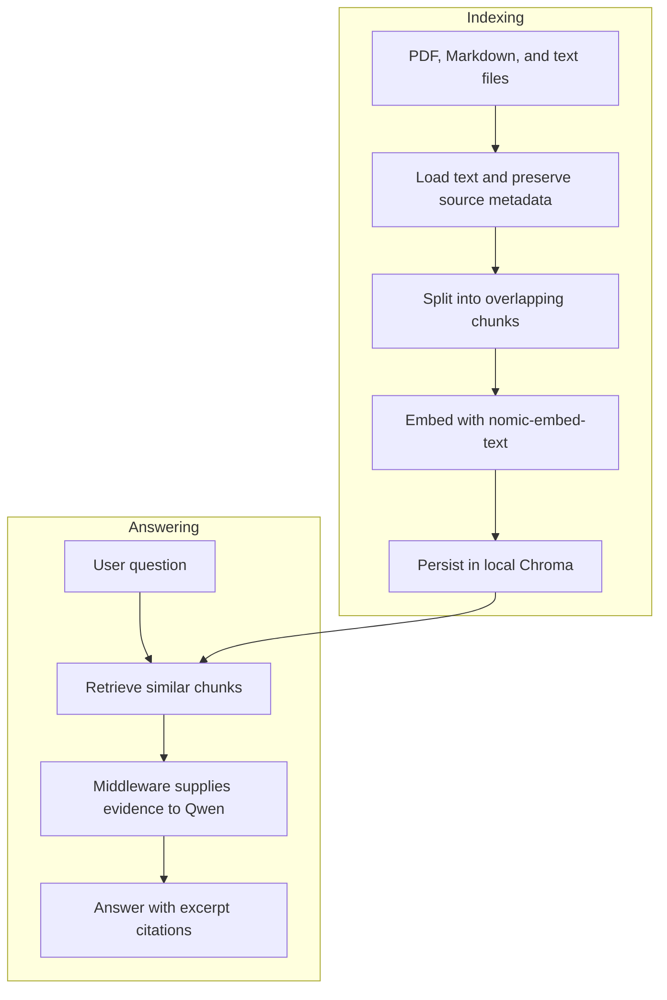

# Local Document RAG Q&A Agent

A local document question-answering project using LangChain v1, Ollama,
Qwen, and Chroma. Built to learn retrieval-augmented generation and
explore evidence-based answers for Build, Release and Integration engineering.

Adapted from [Darsh Shah's freeCodeCamp tutorial](https://www.freecodecamp.org/news/build-a-private-rag-qa-ai-agent-for-your-documents-using-langchain).

## Architecture



Retrieval runs for every question. The model does not choose whether to
search. Each question is independent; conversational memory is not enabled.

## Features

- Reads Markdown, plain text, and text-extractable PDFs.
- Preserves filenames and PDF page numbers.
- Persists document embeddings in a local Chroma index.
- Supplies retrieved excerpts through LangChain model-call middleware.
- Prompts the model to acknowledge missing information.
- Prints retrieved sources and elapsed time.

## Requirements

- Python 3.12, tested with 3.12.10 on Windows.
- Ollama running locally.
- Models: qwen3.5:4b and nomic-embed-text.

## Setup on Windows PowerShell

```powershell
python -m venv .venv
.\.venv\Scripts\Activate.ps1
python -m pip install -r requirements.txt
ollama pull qwen3.5:4b
ollama pull nomic-embed-text
python .\qa_agent.py
```

The first run indexes files under docs/. Subsequent runs reuse the index.
Type exit to stop.

The included Cedar, Maple, and Birch documents are fictional test fixtures.
Files placed under docs/ become part of the retrieval corpus.

## Example questions

- Why did build CEDAR-104 fail?
- What is required for a Cedar release?
- How much free disk space is required before rerunning BIRCH-309?
- Did MAPLE-207 fail because the runner ran out of disk space?

## Configuration

Edit the constants near the top of qa_agent.py:

| Setting | Current value |
| --- | --- |
| Chat model | qwen3.5:4b |
| Embedding model | nomic-embed-text |
| Chunk size | 1000 characters |
| Chunk overlap | 200 characters |
| Retrieved chunks | 2 |

## Updating the document index

Document changes are not detected automatically. Stop the agent, archive
the index, and restart after changing documents, chunk settings, or the
embedding model:

```powershell
if (Test-Path .\db) {
    Move-Item .\db ("db-backup-" + (Get-Date -Format "yyyyMMdd-HHmmss"))
}
python .\qa_agent.py
```

Changing only RETRIEVAL_K does not require rebuilding the index.

## Initial verification

Manual checks verified local embeddings, index reuse, direct answers
across three documents, and missing-information handling.

One misleading question exposed a retrieval miss at k=1. Retrieving two
chunks supplied the missing Maple evidence and enabled a correct answer.

| Retrieved chunks | Evidence | Outcome |
| --- | --- | --- |
| 1 | Birch | Abstained because Maple evidence was missing |
| 2 | Birch and Maple | Corrected the premise and cited Maple |

This is one observed comparison, not a general performance claim.

See [the verification record](verification/initial-results.md) for details.

## Limitations

- Citations are model-generated and require checking against the evidence.
- A retrieved source does not automatically support every answer claim.
- Similarity search can retrieve irrelevant documents.
- Refusal and document-instruction handling are prompt-based, not guaranteed.
- Scanned PDFs require OCR, which is not implemented.
- PDF loading and page citations passed three initial smoke checks; broader PDF coverage remains unverified.
- No automated evaluation suite or conversational memory is included.
- Dependency versions reflect the tested Windows environment.

## Local execution and document handling

Chat generation and embeddings are configured to use local Ollama models,
with Chroma storing the index on disk. This configuration has not been
audited for all dependency telemetry or externally enabled tracing.

The Git ignore rules exclude the local index, index backups, virtual
environment, and .env file. The docs/ folder is tracked: review documents
before committing and keep private material out of the public repository.

## Learning and research direction

This project is a foundation for an Engineering Evidence Assistant.
Future work can evaluate retrieval accuracy, citation support,
multi-document questions, and answers with and without retrieved evidence.

## 🎨 Visual Guide and PDF Verification

See the [colored visual guide](guides/VISUAL_GUIDE.md) for architecture,
citation interpretation, and verification status.

Three Atlas PDF smoke checks verified page-specific evidence for release
approval, build recovery, and missing deployment information.
See the [PDF verification record](verification/pdf-results.md).

Regenerate the fictional two-page PDF with:

```powershell
python .\tools\make_demo_pdf.py
```

