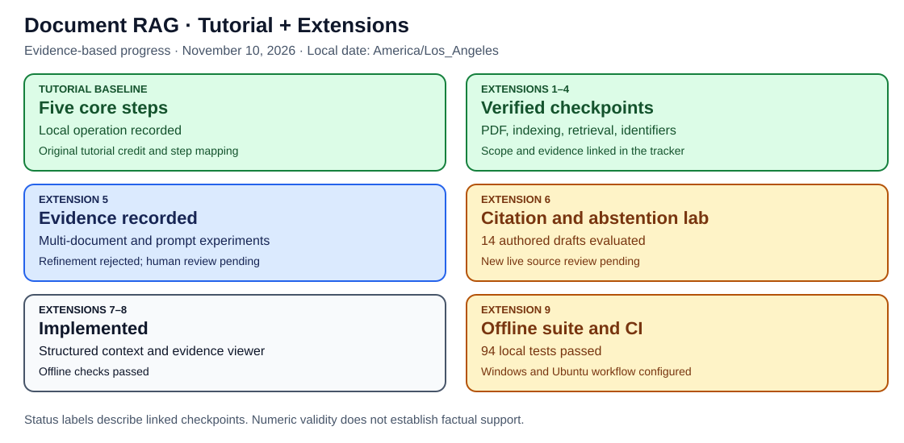
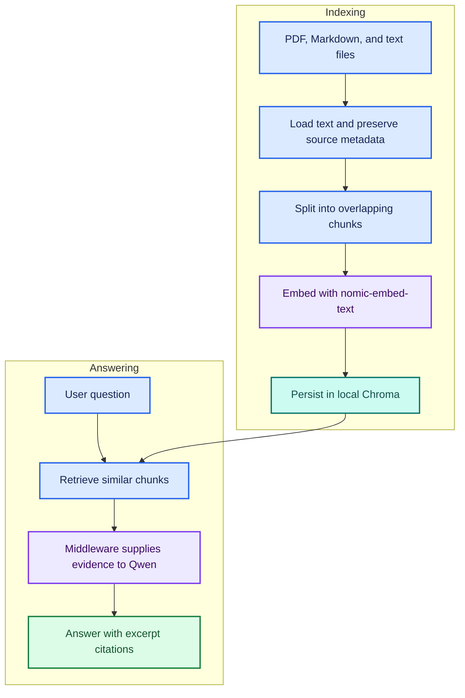

# 📚 Local Document RAG Q&A Agent

> **📚 Tutorial foundation:** Based on [Darsh Shah's freeCodeCamp tutorial](https://www.freecodecamp.org/news/build-a-private-rag-qa-ai-agent-for-your-documents-using-langchain). See [Tutorial Acknowledgment and Attribution](#tutorial-acknowledgment-and-attribution).


**🟦 Learn AI · 🟩 Portfolio evidence · 🟪 PhD research · 🟠 Planned work**

<a id="explore-the-project"></a>

## 🧭 Explore the project

[🗺️ Tutorial + extension tracker](guides/PROJECT_TRACKER.md) · [🧩 Architecture](#architecture) · [🚀 Setup](#setup-on-windows-powershell) · [🧪 Results & verification](#initial-verification) · [🗂️ Evidence & guides](#visual-guide-and-pdf-verification) · [🧪 Evaluation lab](#retrieval-evaluation-lab) · [📊 Measured results](#recorded-retrieval-results) · [🔎 Identifier retrieval](#identifier-aware-retrieval) · [📚 Multi-document lab](#multi-document-answer-evaluation) · [🧪 Prompt comparison](#frozen-context-prompt-comparison) · [🧪 Refinement](#second-prompt-refinement) · [🔗 Citation guard](#citation-guard) · [📋 Verification dashboard](verification/DASHBOARD.md) · [🎨 Visual standard](VISUAL_STYLE.md)

🎨 [Shared architecture colors and diagram conventions](VISUAL_STYLE.md)

A local document question-answering project using LangChain v1, Ollama,
Qwen, and Chroma. Built to learn retrieval-augmented generation and
explore evidence-based answers for Build, Release and Integration engineering.

Adapted from [Darsh Shah's freeCodeCamp tutorial](https://www.freecodecamp.org/news/build-a-private-rag-qa-ai-agent-for-your-documents-using-langchain).

## 🗺️ Tutorial and Extension Progress



**[Open the full tutorial + extension tracker](guides/PROJECT_TRACKER.md)** for
separate tables of the five base tutorial steps, Extensions 1–9, evidence links,
and remaining work. Current work is Extension 6: its numeric guard is locally
exercised, while claim support and semantic-abstention evaluation remain pending.

The [shared project documentation standard](PROJECT_STANDARD.md) preserves the
same base-tutorial-then-extensions pattern used in
[Project 1](https://github.com/anne500/multi-agent-study-guide), with readable
colors, diagrams, provenance, verification, and explicit pending work.

<a id="architecture"></a>

## 🧩 Architecture



Retrieval runs for every question. The model does not choose whether to
search. Each question is independent; conversational memory is not enabled.

<a id="features"></a>

## ✨ Features

- Reads Markdown, plain text, and text-extractable PDFs.
- Preserves filenames and PDF page numbers.
- Persists document embeddings in a local Chroma index.
- Supplies retrieved excerpts through LangChain model-call middleware.
- Prompts the model to acknowledge missing information.
- Prints retrieved sources and elapsed time.

<a id="requirements"></a>

## 🧰 Requirements

- Python 3.12, tested with 3.12.10 on Windows.
- Ollama running locally.
- Models: qwen3.5:4b and nomic-embed-text.

<a id="setup-on-windows-powershell"></a>

## 🚀 Setup on Windows PowerShell

```powershell
python -m venv .venv
.\.venv\Scripts\Activate.ps1
python -m pip install -r requirements.txt
ollama pull qwen3.5:4b
ollama pull nomic-embed-text
python .\qa_agent.py
```

Each startup checks files under docs/. Matching completed indexes are reused.
Type exit to stop.

The included Cedar, Maple, and Birch documents are fictional test fixtures.
Files placed under docs/ become part of the retrieval corpus.

<a id="example-questions"></a>

## 💬 Example questions

- Why did build CEDAR-104 fail?
- What is required for a Cedar release?
- How much free disk space is required before rerunning BIRCH-309?
- Did MAPLE-207 fail because the runner ran out of disk space?

<a id="configuration"></a>

## ⚙️ Configuration

Edit the constants near the top of qa_agent.py:

| Setting | Current value |
| --- | --- |
| Chat model | qwen3.5:4b |
| Embedding model | nomic-embed-text |
| Chunk size | 1000 characters |
| Chunk overlap | 200 characters |
| Retrieved chunks | 2 |

<a id="updating-the-document-index"></a>

## 💾 Automatic Startup Index Refresh

At startup, the agent fingerprints extracted document text, source metadata,
embedding model name, chunk settings, and splitter/PDF-reader versions.

| Change | Startup behavior |
| --- | --- |
| Add a document | Build an index for the updated corpus |
| Edit a document | Build an index containing the updated text |
| Remove a document | Select an index that excludes it |
| No changes | Reuse the matching completed index |

Changes made during a session take effect after restarting the agent.
Each new corpus version rebuilds the complete index.
Changing only RETRIEVAL_K does not rebuild it.

Indexes are stored in version-specific folders under db/.
Historical indexes retain their content, including removed documents.
This feature does not provide secure erasure or automatic index cleanup.

Replacing an embedding model under the same model name is not detected.

See [startup-refresh verification](verification/index-refresh-results.md).

<a id="initial-verification"></a>

## 🧪 Initial verification

Manual checks verified local embeddings, index reuse, direct answers
across three documents, and missing-information handling.

One misleading question exposed a retrieval miss at k=1. Retrieving two
chunks supplied the missing Maple evidence and enabled a correct answer.

| Retrieved chunks | Evidence | Outcome |
| --- | --- | --- |
| 1 | Birch | Abstained because Maple evidence was missing |
| 2 | Birch and Maple | Corrected the premise and cited Maple |

This is one observed comparison, not a general performance claim.

See [the verification record](verification/initial-results.md) for details.

<a id="limitations"></a>

## ⚠️ Limitations

- Citations are model-generated and require checking against the evidence.
- A retrieved source does not automatically support every answer claim.
- Similarity search can retrieve irrelevant documents.
- Refusal and document-instruction handling are prompt-based, not guaranteed.
- Scanned PDFs require OCR, which is not implemented.
- PDF loading and page citations passed three initial smoke checks; broader PDF coverage remains unverified.
- Retrieval and multi-document answer-capture labs are included; answer quality requires human review. Conversational memory is not implemented.
- Dependency versions reflect the tested Windows environment.

<a id="local-execution-and-document-handling"></a>

## 🔒 Local execution and document handling

Chat generation and embeddings are configured to use local Ollama models,
with Chroma storing the index on disk. This configuration has not been
audited for all dependency telemetry or externally enabled tracing.

The Git ignore rules exclude the local index, index backups, virtual
environment, and .env file. The docs/ folder is tracked: review documents
before committing and keep private material out of the public repository.

<a id="learning-and-research-direction"></a>

## 🧭 Learning and research direction

This project is a foundation for an Engineering Evidence Assistant.
Future work can evaluate retrieval accuracy, citation support,
multi-document questions, and answers with and without retrieved evidence.

<a id="visual-guide-and-pdf-verification"></a>

## 🎨 Visual Guide and PDF Verification

See the [colored visual guide](guides/VISUAL_GUIDE.md) for architecture,
citation interpretation, and verification status.

Three Atlas PDF smoke checks verified page-specific evidence for release
approval, build recovery, and missing deployment information.
See the [PDF verification record](verification/pdf-results.md).

Regenerate the fictional two-page PDF with:

```powershell
python .\tools\make_demo_pdf.py
```


<a id="retrieval-evaluation-lab"></a>

## 🧪 Retrieval Evaluation Lab

Compare retrieval settings on 14 authored questions: 12 evidence cases and
2 unscored no-evidence controls. This extension evaluates retrieval without
calling the chat model or changing the interactive agent index.

| 🟦 Learn | 🟩 Inspect on GitHub | 🟪 Research connection |
| --- | --- | --- |
| Compare 500/1000-character chunks at k=1,2,3 | JSON evidence, CSV, and a colored results dashboard | Separate evidence retrieval from answer generation |
| Check source, PDF page, and authored text markers | Per-question ranks and matched evidence groups | Traceable evaluation labels and documented limitations |

**Verification status:** the initial 21 tests passed on Windows and the first
local embedding run completed. All saved scores were recomputed during audit.
After the CSV formatting fix, 22 offline tests passed in development.

```powershell
python -m unittest discover -s tests -v
python .\eval_retrieval.py --validate-only
python .\eval_retrieval.py
```

The runner saves each unique experiment under verification/retrieval-runs/.
After inspection, the actual run directory can be committed with its dashboard.

[📊 Lab guide and metric definitions](guides/RETRIEVAL_LAB.md) ·
[📋 Verification dashboard](verification/DASHBOARD.md) ·
[🗂️ Authored cases](evaluation/cases.json) ·
[🧪 Offline verification](verification/retrieval-lab-implementation.md)

<a id="identifier-aware-retrieval"></a>

## 🔎 Identifier-Aware Retrieval

**🟩 Paired local run audited; one interactive Maple answer and its citations checked.**

The optional mode prioritizes whole build/release IDs, then uses semantic
candidates to fill remaining positions. Unknown IDs and questions without IDs
fall back to semantic order. Matching is case-insensitive and token-based:
MAPLE-207 does not match MAPLE-2070.

| Mode | Purpose | Status |
| --- | --- | --- |
| Semantic | Existing default and published baseline | Local results audited |
| ID priority | Exact-ID selection plus semantic fallback | Paired run audited; one interactive answer/citation check passed |

```powershell
python -m unittest discover -s tests -v
python .\eval_id_retrieval.py --validate-only
python .\eval_id_retrieval.py
```

To try the interactive mode explicitly:

```powershell
python .\qa_agent.py --retrieval-mode id_priority
```

The paired runner compares both methods on the same questions and semantic
candidate lists, saves regressions, and generates two colored charts.
It does not invoke Qwen or modify the existing semantic experiment artifacts.
The first paired run improved Maple's rank from 2 to 1 at both chunk sizes.
One interactive Maple example correctly cited its expired certificate as [1]
and Birch's disk-space failure as [2]. See the [manual verification record](verification/identifier-interactive-20261110.md).
Broader answer-quality improvements remain unestablished.

### 📊 First Paired Results

| At k=1 | Semantic completeness | ID-priority completeness | Complete-evidence regressions |
| --- | ---: | ---: | ---: |
| 500-character chunks | 8/12 | 9/12 | 0 |
| 1000-character chunks | 9/12 | 10/12 | 0 |


No tested metric regressed in this run. All 12 semantic-fallback pairs retained
identical results. At k=2, both methods covered every authored evidence group;
ID priority placed supporting evidence earlier.

Keep k=2 for multi-source questions. The corpus is tiny and fictional, and the
semantic pools contained every chunk: this is evidence of reranking, not a
measured benefit from finding evidence outside a truncated pool.

[📊 Full paired dashboard](verification/identifier-runs/20261110T200859Z-0651f827/summary.md) ·
[🔬 Evidence audit and limits](verification/identifier-run-audit-20261110.md)

[🧩 Colored workflow and matching rules](guides/IDENTIFIER_RETRIEVAL.md) ·
[🧪 Implementation verification](verification/id-retrieval-implementation.md) ·
[📋 Verification dashboard](verification/DASHBOARD.md)

<a id="recorded-retrieval-results"></a>

## 📊 Recorded Retrieval Results

**🟩 First local run completed and audited: November 10, 2026.**


| Configuration | Complete evidence | Coverage | MRR | Precision |
| --- | ---: | ---: | ---: | ---: |
| 500 characters, k=1 | 66.7% | 75.0% | 0.833 | 83.3% |
| 500 characters, k=2 | 100% | 100% | 0.917 | 58.3% |
| 1000 characters, k=1 | 75.0% | 83.3% | 0.917 | 91.7% |
| 1000 characters, k=2 | 100% | 100% | 0.958 | 58.3% |

At k=3, coverage was unchanged and precision fell to 38.9% for both chunk sizes.
The working demo remains at 1000 characters and k=2.

The misleading Maple question retrieved Birch first and Maple second. The
Atlas cross-page question needed both PDF pages. These failures at k=1 are
preserved alongside the successful k=2 results.

**Scope:** 12 authored evidence cases on four fictional files; two no-evidence
controls excluded from averages. This is not 100% generated-answer accuracy,
a held-out benchmark, or a thesis-effectiveness result.

[📊 Full six-setting dashboard](verification/retrieval-runs/20261110T184155Z-a94eff34/summary.md) ·
[🔬 Evidence audit and limitations](verification/retrieval-run-audit-20261110.md) ·
[🗂️ JSON report](verification/retrieval-runs/20261110T184155Z-a94eff34/report.json) ·
[📋 Verification status](verification/DASHBOARD.md)

<a id="multi-document-answer-evaluation"></a>

## 📚 Multi-Document Answer Evaluation

**🟩 First 13-answer capture audited; assistant source review recorded.
🟠 Independent human ratings pending.**

The agent already combined Cedar/Maple notes and two Atlas PDF pages. Its
Birch answer correctly identified unspecified requirements but added the
unsupported wording “explicitly omitted.” See the [manual record](verification/multidoc-manual-20261110.md).

Extension 5 preserves the existing agent as a baseline and adds seven authored
cases: two-document answers, cross-page citations, missing information,
three/four-unit evidence, absent Willow, and a separate conflicting-note control.

| Layer | Check |
| --- | --- |
| 🔎 Retrieval | Automatic source/page/evidence-marker coverage |
| 🔗 Citation syntax | Numeric labels refer to available excerpts |
| 🟠 Answer quality | Human completeness, attribution, citation-support, and uncertainty ratings |

```powershell
python -m unittest discover -s tests -v
python .\eval_multidoc.py --suite all --validate-only
python .\eval_multidoc.py --suite all
```

The full run captures six retrieved cases at k=2 and k=4 using shared ranked
candidates, plus one direct-context conflict control: 13 chat calls. It saves
answers, excerpts, provenance, and an initially unreviewed worksheet under
verification/multidoc-runs/. Capture completion is not an answer-quality pass.
The interactive application still uses its existing prompt and defaults.

### 📊 First Multi-Document Findings

| On six authored retrieved cases | k=2 | k=4 |
| --- | ---: | ---: |
| Complete evidence-marker groups | 4/6 | 6/6 |
| Assistant-reviewed expected-answer completeness | 4/6 | 6/6 |
| Assistant-reviewed citation support | 4/6 | 5/6 |

The deeper context supplied missing Cedar approval evidence and Birch/Atlas
failure evidence. Both broader answers then included the expected facts.
Birch still acquired an unsupported rerun restriction at k=4, showing that
complete evidence does not guarantee a supported answer. The separate Larch
conflict control disclosed disagreement without selecting an unsupported policy.

These are one AI assistant's proposed ratings on a small development set,
not human-scored accuracy. The original human worksheet remains unreviewed.
The saved citation regex also misses grouped labels such as [1, 2]; a supplemental
audit checked those labels without changing the raw report.

[🔬 Evidence audit, full ratings, and limitations](verification/multidoc-run-audit-20261110.md) ·
[📊 Raw capture dashboard](verification/multidoc-runs/20261110T222813Z-bc04d7e8/summary.md)

[🎨 Workflow and scoring rubric](guides/MULTIDOC_EVALUATION.md) ·
[🗂️ Cases](evaluation/multidoc-cases.json) ·
[🧪 Implementation checks](verification/multidoc-implementation.md)

<a id="frozen-context-prompt-comparison"></a>

## 🧪 Frozen-Context Prompt Comparison

**🟩 First 26-answer prompt capture audited; assistant source review recorded. 🟠 Independent human ratings pending.**

Extension 5 exposed unsupported Birch claims even when all necessary evidence
was present. The follow-up tests a revised instruction set using the exact
saved excerpts. Both original-prompt and revised-prompt answers are generated
fresh, with identical questions, context text, source/page labels, and model
settings within each pair. Call order alternates by context.

```powershell
python -m unittest discover -s tests -v
python .\eval_prompt_comparison.py --validate-only
python .\eval_prompt_comparison.py
```

The full run uses 13 frozen contexts and captures 26 answers without retrieval
or embedding calls. It saves prompt/context hashes, exact answers, provenance,
and an unreviewed worksheet under verification/prompt-runs/. The revised prompt
is experimental; the interactive agent keeps its existing default prompt.

The new runner checks both [1] and grouped [1, 2] citation syntax. This does
not establish factual citation support or modify the older report parser.

### 📊 First Paired Prompt Findings

| On 12 retrieved-context pairs | Baseline | Revised |
| --- | ---: | ---: |
| Assistant-reviewed expected-answer completeness | 10/12 | 10/12 |
| Assistant-reviewed citation support | 9/12 | 11/12 |
| Assistant-reviewed uncertainty | 11/12 | 12/12 |

The revision removed both targeted Birch claims. Willow's k=2 citation-scope
issue persists, and the three-project k=2 answer adds supported build-recovery
advice under a release-check heading. Completeness remains limited by the
same missing k=2 evidence. Both prompts disclose the separate Larch conflict.

These are proposed AI assistant ratings on authored development cases;
independent human review remains pending. Keep the revised prompt experimental
while the remaining citation and scope issues are addressed. The interactive
default is unchanged.

[🔬 Full audit, ratings, caveats, and adoption recommendation](verification/prompt-run-audit-20261110.md) ·
[📊 Raw paired capture](verification/prompt-runs/20261110T232200Z-d0f222aa/summary.md)

[🎨 Comparison design and review](guides/PROMPT_COMPARISON.md) ·
[🧪 Offline verification](verification/prompt-comparison-implementation.md) ·
[🔬 Source findings](verification/multidoc-run-audit-20261110.md)

<a id="second-prompt-refinement"></a>

## 🧪 Second Prompt Refinement

**🟩 39-answer capture audited. 🔴 Refined candidate rejected for adoption. 🟠 Independent human ratings pending.**

The next candidate targets Willow's context-inventory citation and the placement
of build recovery under release checks. It appends generic scope rules while
preserving both earlier prompt texts. The explicit three-prompt mode generates
baseline, revised, and refined answers using identical saved excerpts; call
order rotates across contexts.

```powershell
python -m unittest discover -s tests -v
python .\eval_prompt_comparison.py --include-refined --validate-only
python .\eval_prompt_comparison.py --include-refined
```

The full comparison uses 13 contexts and 39 local chat calls, with no retrieval
or embeddings. Existing two-prompt commands and the interactive default remain
unchanged. Results and initially unreviewed ratings are saved in a new run.

### 📊 Second Refinement Findings

| On 12 retrieved-context comparisons | Baseline | Revised | Refined |
| --- | ---: | ---: | ---: |
| Assistant-reviewed completeness | 10/12 | 10/12 | 10/12 |
| Assistant-reviewed citation support | 9/12 | 11/12 | 6/12 |
| Out-of-range citation answers | 0 | 0 | 2 |

The refined prompt generated nonexistent [7] citations for two context-limited
answers and added an unjustified limitation to Cedar/Maple. Willow's unrelated
source citation also persists. Keep this negative result; the refinement is
not adopted and the interactive default is unchanged. These are proposed AI
source-review ratings, with independent human review pending.

The audit helper now separates accurately saved model errors from artifact
corruption: it reports the two citation warnings while passing consistency.

[🔬 Full refinement audit and rejection rationale](verification/prompt-refinement-run-audit-20261110.md) ·
[📊 Raw capture](verification/prompt-runs/20261111T001306Z-98deeb8f/summary.md)

[🎨 Refinement design and review checks](guides/PROMPT_REFINEMENT.md) ·
[🧪 Verification](verification/prompt-refinement-implementation.md)

<a id="citation-guard"></a>

## 🔗 Extension 6: Citation and Abstention Evaluation

**🟩 Numeric guard and two live retry outcomes audited; 89 development tests passed.
🟠 Factual-support and broader semantic-abstention evaluation pending.**

The optional answer-boundary check validates numeric labels before display,
retries once using the same excerpts, and withholds a still-invalid answer.
It never fixes a draft by deleting its references. A valid/no-label answer can
still be unsupported; factual support and semantic abstention are separate checks.

```powershell
python -m unittest discover -s tests -v
python .\eval_citation_guard.py --validate-only
python .\eval_citation_guard.py --repair-invalid
```

The evaluation replays 39 saved first drafts and makes only two live repair
calls for the observed [7] failures. Development offline replay withheld both
failures, without calling a model. In the first live repair run, one draft was
withheld after another invalid [7]; the Willow repair passed numeric checks
but still cited unrelated Birch [4]. [Read the source audit](verification/citation-guard-live-audit-20261110.md).

To opt into the guard in the interactive app:

```powershell
python .\qa_agent.py --retrieval-mode id_priority --citation-guard
```

The original interactive mode remains available without the flag.

[🎨 Guard behavior and evaluation limits](guides/CITATION_GUARD.md) ·
[🧪 Implementation checks](verification/citation-guard-implementation.md) ·
[🗺️ Tutorial + extension status tracker](guides/PROJECT_TRACKER.md) ·
[Extension numbering](guides/EXTENSION_ROADMAP.md)

<a id="tutorial-acknowledgment-and-attribution"></a>

## 📚 Tutorial Acknowledgment and Attribution

We acknowledge **Darsh Shah**, author of the foundational tutorial published by **freeCodeCamp**:

**[How to Build a RAG Q&A AI Agent for Your Documents Using LangChain v1](https://www.freecodecamp.org/news/build-a-private-rag-qa-ai-agent-for-your-documents-using-langchain)**

Published: July 2, 2026.

| Provenance | Description |
| --- | --- |
| Original author | Darsh Shah |
| Publisher | freeCodeCamp |
| Tutorial foundation | Local document loading, chunking, Ollama embeddings, Chroma persistence, retrieval middleware, and document Q&A |
| Repository extensions | Fictional project fixtures, page-specific PDF verification, retrieval experiments, automatic startup index refresh, retrieval evaluation, identifier-priority comparison, multi-document answer-review, frozen-context prompt comparison labs, and citation-guard evaluation, verification records, and visual documentation |

The original tutorial is credited for the learning foundation. Repository adaptations, experiments, and research connections are documented separately.


