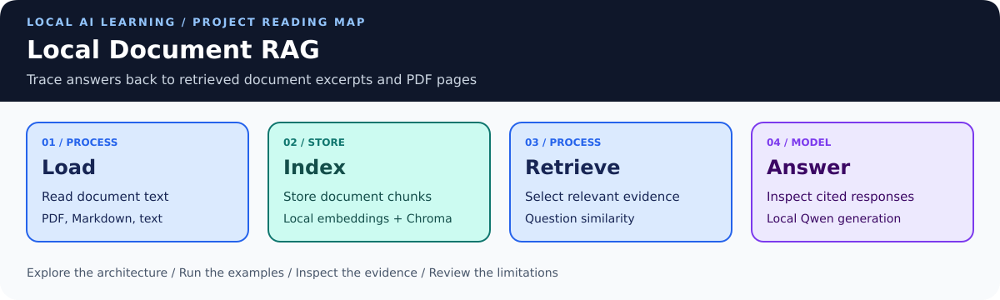
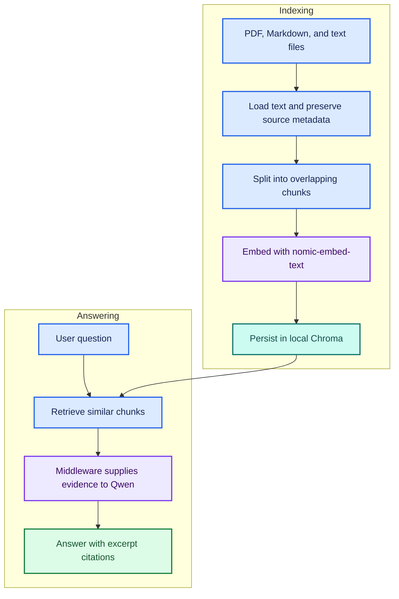
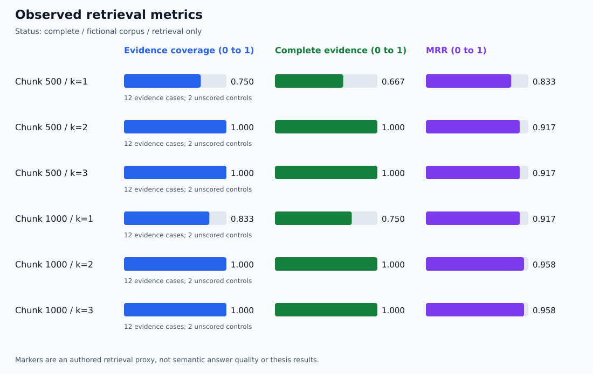

# 📚 Local Document RAG Q&A Agent

> **📚 Tutorial foundation:** Based on [Darsh Shah's freeCodeCamp tutorial](https://www.freecodecamp.org/news/build-a-private-rag-qa-ai-agent-for-your-documents-using-langchain). See [Tutorial Acknowledgment and Attribution](#tutorial-acknowledgment-and-attribution).



**🟦 Learn AI · 🟩 Portfolio evidence · 🟪 PhD research · 🟠 Planned work**

<a id="explore-the-project"></a>

## 🧭 Explore the project

[🧩 Architecture](#architecture) · [🚀 Setup](#setup-on-windows-powershell) · [🧪 Results & verification](#initial-verification) · [🗂️ Evidence & guides](#visual-guide-and-pdf-verification) · [🧪 Evaluation lab](#retrieval-evaluation-lab) · [📊 Measured results](#recorded-retrieval-results) · [📋 Verification dashboard](verification/DASHBOARD.md) · [🎨 Visual standard](VISUAL_STYLE.md)

🎨 [Shared architecture colors and diagram conventions](VISUAL_STYLE.md)

A local document question-answering project using LangChain v1, Ollama,
Qwen, and Chroma. Built to learn retrieval-augmented generation and
explore evidence-based answers for Build, Release and Integration engineering.

Adapted from [Darsh Shah's freeCodeCamp tutorial](https://www.freecodecamp.org/news/build-a-private-rag-qa-ai-agent-for-your-documents-using-langchain).

<a id="architecture"></a>

## 🧩 Architecture



Retrieval runs for every question. The model does not choose whether to
search. Each question is independent; conversational memory is not enabled.

<a id="features"></a>

## ✨ Features

- Reads Markdown, plain text, and text-extractable PDFs.
- Preserves filenames and PDF page numbers.
- Persists document embeddings in a local Chroma index.
- Supplies retrieved excerpts through LangChain model-call middleware.
- Prompts the model to acknowledge missing information.
- Prints retrieved sources and elapsed time.

<a id="requirements"></a>

## 🧰 Requirements

- Python 3.12, tested with 3.12.10 on Windows.
- Ollama running locally.
- Models: qwen3.5:4b and nomic-embed-text.

<a id="setup-on-windows-powershell"></a>

## 🚀 Setup on Windows PowerShell

```powershell
python -m venv .venv
.\.venv\Scripts\Activate.ps1
python -m pip install -r requirements.txt
ollama pull qwen3.5:4b
ollama pull nomic-embed-text
python .\qa_agent.py
```

Each startup checks files under docs/. Matching completed indexes are reused.
Type exit to stop.

The included Cedar, Maple, and Birch documents are fictional test fixtures.
Files placed under docs/ become part of the retrieval corpus.

<a id="example-questions"></a>

## 💬 Example questions

- Why did build CEDAR-104 fail?
- What is required for a Cedar release?
- How much free disk space is required before rerunning BIRCH-309?
- Did MAPLE-207 fail because the runner ran out of disk space?

<a id="configuration"></a>

## ⚙️ Configuration

Edit the constants near the top of qa_agent.py:

| Setting | Current value |
| --- | --- |
| Chat model | qwen3.5:4b |
| Embedding model | nomic-embed-text |
| Chunk size | 1000 characters |
| Chunk overlap | 200 characters |
| Retrieved chunks | 2 |

<a id="updating-the-document-index"></a>

## 💾 Automatic Startup Index Refresh

At startup, the agent fingerprints extracted document text, source metadata,
embedding model name, chunk settings, and splitter/PDF-reader versions.

| Change | Startup behavior |
| --- | --- |
| Add a document | Build an index for the updated corpus |
| Edit a document | Build an index containing the updated text |
| Remove a document | Select an index that excludes it |
| No changes | Reuse the matching completed index |

Changes made during a session take effect after restarting the agent.
Each new corpus version rebuilds the complete index.
Changing only RETRIEVAL_K does not rebuild it.

Indexes are stored in version-specific folders under db/.
Historical indexes retain their content, including removed documents.
This feature does not provide secure erasure or automatic index cleanup.

Replacing an embedding model under the same model name is not detected.

See [startup-refresh verification](verification/index-refresh-results.md).

<a id="initial-verification"></a>

## 🧪 Initial verification

Manual checks verified local embeddings, index reuse, direct answers
across three documents, and missing-information handling.

One misleading question exposed a retrieval miss at k=1. Retrieving two
chunks supplied the missing Maple evidence and enabled a correct answer.

| Retrieved chunks | Evidence | Outcome |
| --- | --- | --- |
| 1 | Birch | Abstained because Maple evidence was missing |
| 2 | Birch and Maple | Corrected the premise and cited Maple |

This is one observed comparison, not a general performance claim.

See [the verification record](verification/initial-results.md) for details.

<a id="limitations"></a>

## ⚠️ Limitations

- Citations are model-generated and require checking against the evidence.
- A retrieved source does not automatically support every answer claim.
- Similarity search can retrieve irrelevant documents.
- Refusal and document-instruction handling are prompt-based, not guaranteed.
- Scanned PDFs require OCR, which is not implemented.
- PDF loading and page citations passed three initial smoke checks; broader PDF coverage remains unverified.
- An automated retrieval evaluation lab is included; generated-answer evaluation and conversational memory are not implemented.
- Dependency versions reflect the tested Windows environment.

<a id="local-execution-and-document-handling"></a>

## 🔒 Local execution and document handling

Chat generation and embeddings are configured to use local Ollama models,
with Chroma storing the index on disk. This configuration has not been
audited for all dependency telemetry or externally enabled tracing.

The Git ignore rules exclude the local index, index backups, virtual
environment, and .env file. The docs/ folder is tracked: review documents
before committing and keep private material out of the public repository.

<a id="learning-and-research-direction"></a>

## 🧭 Learning and research direction

This project is a foundation for an Engineering Evidence Assistant.
Future work can evaluate retrieval accuracy, citation support,
multi-document questions, and answers with and without retrieved evidence.

<a id="visual-guide-and-pdf-verification"></a>

## 🎨 Visual Guide and PDF Verification

See the [colored visual guide](guides/VISUAL_GUIDE.md) for architecture,
citation interpretation, and verification status.

Three Atlas PDF smoke checks verified page-specific evidence for release
approval, build recovery, and missing deployment information.
See the [PDF verification record](verification/pdf-results.md).

Regenerate the fictional two-page PDF with:

```powershell
python .\tools\make_demo_pdf.py
```


<a id="retrieval-evaluation-lab"></a>

## 🧪 Retrieval Evaluation Lab

Compare retrieval settings on 14 authored questions: 12 evidence cases and
2 unscored no-evidence controls. This extension evaluates retrieval without
calling the chat model or changing the interactive agent index.

| 🟦 Learn | 🟩 Inspect on GitHub | 🟪 Research connection |
| --- | --- | --- |
| Compare 500/1000-character chunks at k=1,2,3 | JSON evidence, CSV, and a colored results dashboard | Separate evidence retrieval from answer generation |
| Check source, PDF page, and authored text markers | Per-question ranks and matched evidence groups | Traceable evaluation labels and documented limitations |

**Verification status:** the initial 21 tests passed on Windows and the first
local embedding run completed. All saved scores were recomputed during audit.
After the CSV formatting fix, 22 offline tests passed in development.

```powershell
python -m unittest discover -s tests -v
python .\eval_retrieval.py --validate-only
python .\eval_retrieval.py
```

The runner saves each unique experiment under verification/retrieval-runs/.
After inspection, the actual run directory can be committed with its dashboard.

[📊 Lab guide and metric definitions](guides/RETRIEVAL_LAB.md) ·
[📋 Verification dashboard](verification/DASHBOARD.md) ·
[🗂️ Authored cases](evaluation/cases.json) ·
[🧪 Offline verification](verification/retrieval-lab-implementation.md)

<a id="recorded-retrieval-results"></a>

## 📊 Recorded Retrieval Results

**🟩 First local run completed and audited: November 10, 2026.**



| Configuration | Complete evidence | Coverage | MRR | Precision |
| --- | ---: | ---: | ---: | ---: |
| 500 characters, k=1 | 66.7% | 75.0% | 0.833 | 83.3% |
| 500 characters, k=2 | 100% | 100% | 0.917 | 58.3% |
| 1000 characters, k=1 | 75.0% | 83.3% | 0.917 | 91.7% |
| 1000 characters, k=2 | 100% | 100% | 0.958 | 58.3% |

At k=3, coverage was unchanged and precision fell to 38.9% for both chunk sizes.
The working demo remains at 1000 characters and k=2.

The misleading Maple question retrieved Birch first and Maple second. The
Atlas cross-page question needed both PDF pages. These failures at k=1 are
preserved alongside the successful k=2 results.

**Scope:** 12 authored evidence cases on four fictional files; two no-evidence
controls excluded from averages. This is not 100% generated-answer accuracy,
a held-out benchmark, or a thesis-effectiveness result.

[📊 Full six-setting dashboard](verification/retrieval-runs/20261110T184155Z-a94eff34/summary.md) ·
[🔬 Evidence audit and limitations](verification/retrieval-run-audit-20261110.md) ·
[🗂️ JSON report](verification/retrieval-runs/20261110T184155Z-a94eff34/report.json) ·
[📋 Verification status](verification/DASHBOARD.md)

<a id="tutorial-acknowledgment-and-attribution"></a>

## 📚 Tutorial Acknowledgment and Attribution

We acknowledge **Darsh Shah**, author of the foundational tutorial published by **freeCodeCamp**:

**[How to Build a RAG Q&A AI Agent for Your Documents Using LangChain v1](https://www.freecodecamp.org/news/build-a-private-rag-qa-ai-agent-for-your-documents-using-langchain)**

Published: July 2, 2026.

| Provenance | Description |
| --- | --- |
| Original author | Darsh Shah |
| Publisher | freeCodeCamp |
| Tutorial foundation | Local document loading, chunking, Ollama embeddings, Chroma persistence, retrieval middleware, and document Q&A |
| Repository extensions | Fictional project fixtures, page-specific PDF verification, retrieval experiments, automatic startup index refresh, a retrieval evaluation lab, verification records, and visual documentation |

The original tutorial is credited for the learning foundation. Repository adaptations, experiments, and research connections are documented separately.
