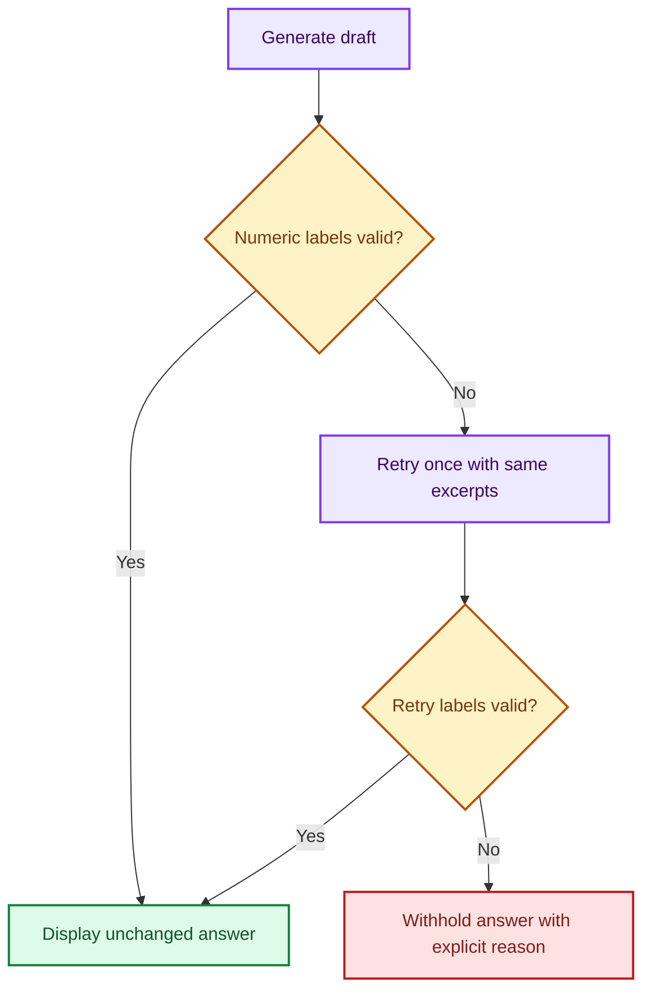

# 🔗 Extension 6: Citation Guard and Abstention Evaluation

**🟩 Numeric guard implemented; 89 development tests passed. 🟠 Live repair and broader semantic abstention evaluation pending.**

This starts Extension 6 in the [Document RAG roadmap](EXTENSION_ROADMAP.md).
The rejected refined prompt remains rejected. The guard is an optional runtime
check, not another adopted prompt revision or a claim of factual validation.

## 🧩 Answer-boundary behavior



The retry gets the same original question and excerpt text, plus a separate
trusted system instruction listing the available labels. It does not receive
or edit the rejected draft. At most two generation attempts are allowed.
The guard preserves raw drafts/checks in its returned trace, but the interactive
app displays only an accepted answer or a fixed withholding/failure message.
It never repairs a draft by deleting an invalid label.

| Condition | Behavior |
| --- | --- |
| Numeric labels in range | Return original answer unchanged |
| Invalid/malformed numeric labels or empty answer | Retry once |
| Retry still invalid | Withhold; explain that labels could not be validated |
| No retrieved excerpts | Abstain before calling the model |
| Generation exception | Return a separate generation-failure message |
| Keyboard interruption | Preserve attempt state in evaluator checkpoints and propagate interruption |

The default interactive mode remains unguarded for historical comparison.
Enable the new mode explicitly:

```powershell
python .\qa_agent.py --retrieval-mode id_priority --citation-guard
```

Source lists remain retrieved evidence, not proof of support for every answer
claim. The app prints guard status and attempt count without rejected drafts.

## 🔎 Exactly what is checked

The check accepts numeric square-bracket forms [1], [1, 2], adjacent labels,
and whitespace inside brackets. It rejects out-of-range labels (including 0),
numeric ranges, signs, unsupported separators, unfinished numeric brackets,
and excessive-length numeric labels. For example [7] is invalid with two excerpts.

It checks numeric-looking bracket spans only. Other citation styles, URLs,
textual citations, and semantic claims are not validated. Bracketed numeric
content used as code/data may be treated as a citation. The opt-in guard has
that documented limitation.

An answer with no numeric citations can pass this check. So can an unsupported
claim citing an existing [1]. Correct source-to-claim support, uncited factual
claims, completeness, and semantic abstention still need separate evaluation.
The guard's accepted status must not be reported as answer accuracy.

## 🚀 Validate and replay the saved failures

```powershell
git pull --ff-only origin main
python -m unittest discover -s tests -v
python .\eval_citation_guard.py --validate-only
```

Expected: **89 passing tests**, **39 saved drafts**, and **two numeric failures**.
The user's earlier 72-test suite was verified on Windows; these new tests still
need their local run. Validation makes no model or index calls.

Optional offline replay:

```powershell
python .\eval_citation_guard.py
```

This replays the 39 saved first drafts. For a rejected draft it deliberately
repeats the same bad draft on the retry, demonstrating withholding rather than
simulating a model repair. Development replay produced 37 numeric acceptances
and two withheld answers, with zero live calls. Those are structural outcomes,
not 37 factually correct answers. The three direct-context conflict answers
remain identifiable separately from the 36 retrieved-context drafts.

## 💬 Targeted live repair: only two new calls

```powershell
python .\eval_citation_guard.py --repair-invalid
```

The first drafts are still replayed from the saved capture. Only the two
invalid drafts receive one new Qwen repair call each; there is no retrieval
or embedding call. Each repair uses its original variant's saved prompt and
exact excerpts plus validation feedback. In this source run both failures
belong to the rejected refined candidate, used solely as guard stress cases.
This does not adopt that candidate in the app.

A repaired answer is accepted only if its numeric check passes. Otherwise
the guard withholds it. A new valid label still needs factual-support review.
This mixed replay/live-repair test is not a fresh paired evaluation of all
39 answers and cannot establish a general retry success rate.

The two cases are three_unit_approvals:k2::refined and known_unknown:k4::refined.
They lack Cedar/Willow evidence respectively. Check that a repair acknowledges
missing information instead of inventing facts with newly valid labels.

## 💾 Evidence and status

Each invocation creates a unique verification/citation-guard-runs/ directory:

| Artifact | Content |
| --- | --- |
| source-report.snapshot.json | Frozen source prompts, contexts, answers, and provenance |
| report.json | Mode, source hash, code hashes, runtime/Git metadata, per-attempt raw drafts, checks, exact retry feedback, context hashes, errors, live-call counts, and live model identity |
| summary.md | Structural pass/withholding statuses and live-call counts |

The evaluator checkpoints each attempt, including before a retry, so failures
and interruption preserve the rejected evidence. It creates a new run rather
than resuming or overwriting old evidence. A generation error remains explicit
and produces completed_with_generation_errors with a nonzero exit code.
Snapshots contain complete document text; current fixtures are fictional.

## 🟠 Remaining Extension 6 work

- Verify the two live repairs and one guarded interactive example locally.
- Evaluate citation support with claim/excerpt review; numeric validity alone is insufficient.
- Separate correct missing-evidence abstention, unnecessary refusal when evidence
  exists, unresolved conflict, and guard-induced withholding in the evaluation rubric.
- Include new questions and independent human review. Do not relabel earlier
  assistant proposals as human ground truth.

This is a bounded first checkpoint for Extension 6. Extension 7 remains
document-instruction robustness, followed by the evidence viewer and CI work.

[Implementation verification](../verification/citation-guard-implementation.md) ·
[Extension roadmap](EXTENSION_ROADMAP.md) ·
[Tutorial acknowledgment](../README.md#tutorial-acknowledgment-and-attribution)
