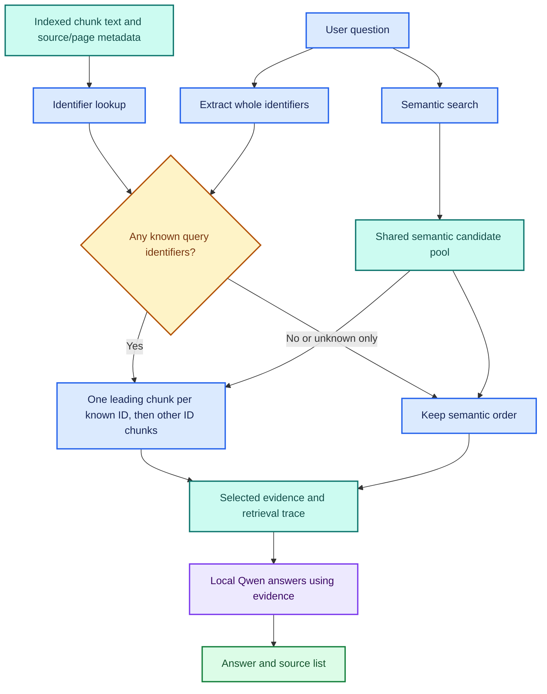
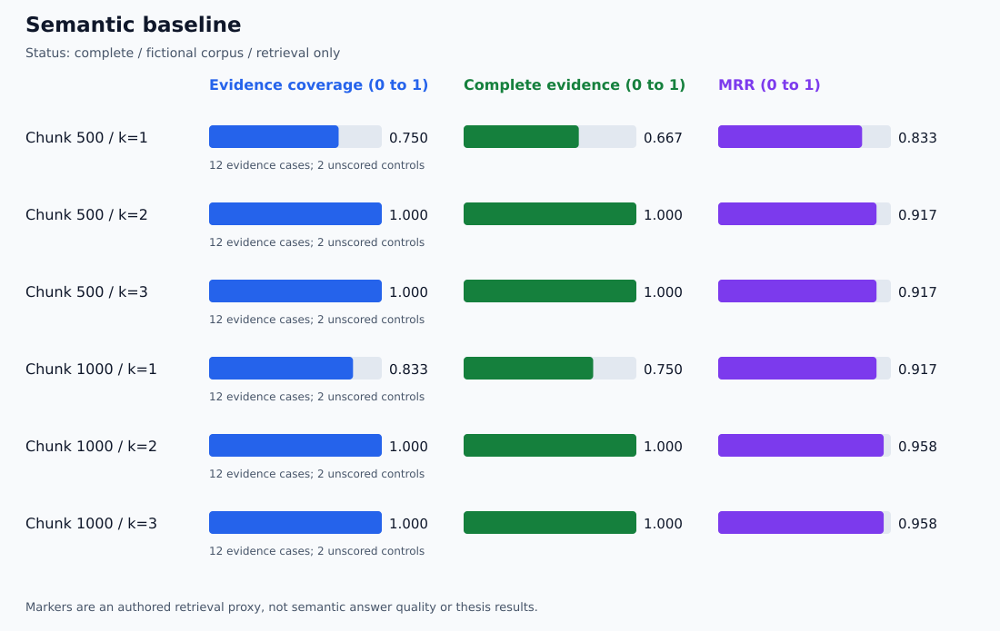

# 🔎 Identifier-Aware Retrieval

**🟦 Learn retrieval control · 🟩 Offline checks passed · 🟪 Paired evaluation · 🟩 Paired local run audited**

This extension prioritizes chunks containing a whole build or release identifier,
then fills remaining positions using semantic retrieval. It is a deterministic
priority rule, not BM25, reciprocal-rank fusion, a learned reranker, or an
answer-quality guarantee.

## 🧩 Architecture



The paired evaluation stops at evidence selection and scoring; it never invokes Qwen.

## 🧭 Why this extension exists

In the [first semantic run](../verification/retrieval-run-audit-20261110.md),
the misleading MAPLE-207 disk-space question retrieved Birch at rank 1 and
Maple at rank 2. That observed failure motivates this rule.

| Stage | Status | Meaning |
| --- | --- | --- |
| Semantic Maple ranking: Birch, then Maple | 🟩 Observed in the published baseline | Supporting evidence was missed at k=1 |
| Whole-ID promotion on controlled passages | 🟩 Offline test passed | MAPLE-207 text can move ahead of a disk-space match |
| New paired embedding experiment | 🟩 First local run audited | Maple promoted; no tested metric regressions in this run |
| New interactive answer quality | 🟠 Pending manual check | A better rank does not prove a better answer |

## 🔢 Identifier rules

- Matching uses ASCII letters, digits, and ASCII hyphens.
- Identifiers start with a letter and contain at least one hyphen.
- The final component is optional letters followed by digits.
- Case is normalized; repeated IDs are collapsed in first-appearance order.
- Matching considers whole tokens, not arbitrary substrings.

| Input | Behavior |
| --- | --- |
| maple-207 | Matches MAPLE-207 |
| ATLAS-R12 | Supported release identifier |
| MAPLE-2070 | A distinct identifier; does not match MAPLE-207 |
| MAPLE-207x | Does not match MAPLE-207 |
| release-ready | Not an identifier |
| MAPLE followed by a non-ASCII hyphen and 207 | Not normalized by this version |

## ⚙️ Ranking policy

1. Build an identifier lookup from the full indexed chunk inventory at startup.
2. Obtain a semantic candidate list, defaulting to at most 20 chunks.
3. For each known query ID, take its best matching chunk by semantic rank.
4. Place one such chunk per ID first, in query-ID order.
5. Append other exact-ID chunks, then the remaining semantic candidates.
6. Deduplicate by source, page, and text when applying ID priority.

If an exact match is outside the semantic pool, deterministic source/page/key
ordering breaks ties. Its semantic distance and rank remain null; no similarity
score is invented.

Queries with no recognized ID or only unknown IDs retain the provided semantic
order. Known and unknown IDs are reported separately. An unknown identifier
does not prove the answer is unavailable; the semantic fallback still runs.

The lookup reads the entire indexed text once, so this adapter targets small
local corpora. It refreshes when the application restarts with the selected index.

## 🚀 Try the interactive mode

```powershell
python .\qa_agent.py --retrieval-mode id_priority
```

Ask:

    Did MAPLE-207 fail because the runner ran out of disk space?

Inspect whether Maple appears first, its certificate passage supports the answer,
and the retrieval trace names MAPLE-207 as matched.

The semantic default remains available:

```powershell
python .\qa_agent.py
```

The ID mode may request a larger semantic candidate pool than the original
interactive semantic path. Approximate-search ties or settings can affect order.
The paired runner below controls this by sharing the same semantic list.

## 🧪 Run the paired evaluation

```powershell
python -m unittest discover -s tests -v
python .\eval_id_retrieval.py --validate-only
python .\eval_id_retrieval.py
```

No new package is required. The runner uses the same 14 authored cases as the
existing evaluation. It compares two chunk sizes, three k values, and two methods:
12 aggregate rows, with no-evidence controls excluded from averages.

Both methods share one embedding search per question and chunk size.
The ID method also has access to the indexed text for exact matches outside
that semantic pool. This is part of the evaluated intervention.

## 🎨 Generated dashboard and evidence

Each run creates:

    verification/identifier-runs/<UTC timestamp>-<unique suffix>/

| Artifact | Contents |
| --- | --- |
| summary.md | Paired table, completeness improvement/regression counts, and both charts |
| semantic-results.svg | Observed semantic coverage, completeness, and MRR |
| id_priority-results.svg | Observed ID-priority coverage, completeness, and MRR |
| metrics.csv | All five metrics for each setting and method; LF line endings |
| paired-deltas.json | Every evidence-case metric delta, including negative values |
| report.json | Full semantic pools, chosen passages, source/page metadata, selection reasons, ID traces, scores, settings, and hashes |
| cases.snapshot.json | Exact authored cases used |
| corpus.snapshot.json | Exact extracted input text used |

The report also preserves each chunk configuration's indexed inventory.
Original semantic ranks and distances remain visible after promotion.
Historical semantic-only runs are not edited.

## 📊 How to assess the result

| Question | Inspect |
| --- | --- |
| Did the Maple passage reach rank 1? | maple_misleading, each method's ranked passages |
| Did other evidence get displaced? | Negative paired deltas and completeness regressions |
| Did questions without IDs change? | Trace policy and both method rankings |
| Were both Atlas pages retained when needed? | atlas_cross_page coverage and page metadata |
| Did the method invent confidence for lexical matches? | Null distance/rank when a chunk was outside the pool |

Hit@k, Complete@k, Coverage@k, MRR@k, and Precision@k use the
[same authored marker definitions](RETRIEVAL_LAB.md) as Extension 3.

## ⚠️ Limits

- Exact ID presence does not establish that a passage answers the question.
- Quoted, negated, repeated, or misleading ID mentions can be prioritized.
- Multiple or stale documents containing the same ID remain ambiguous.
- Small k can still omit evidence for additional IDs or other required sources.
- ASCII ID syntax does not cover every engineering identifier convention.
- Reading all indexed text is not a scalable search architecture.
- This is development-set comparison, not held-out research evidence.
- The runner measures retrieval, not generation, citations, or abstention quality.
- The first observed improvement is limited to this small, authored development set.

## 📚 Tutorial and research provenance

The application foundation remains Darsh Shah's freeCodeCamp tutorial,
[How to Build a RAG Q&A AI Agent for Your Documents Using LangChain v1](https://www.freecodecamp.org/news/build-a-private-rag-qa-ai-agent-for-your-documents-using-langchain).
Whole-ID ranking, paired comparisons, regression checks, and these visuals are
repository-specific learning extensions.

Potential BRI use: distinguish artifact identity from broad semantic similarity.
Real-build evidence, revision identity, freshness, and held-out evaluation would
still be required before making a research-effectiveness claim.

API reference: [LangChain Chroma get](https://reference.langchain.com/python/langchain-chroma/vectorstores/Chroma/get).

## 📊 First Observed Paired Run

The [measured dashboard](../verification/identifier-runs/20261110T200859Z-0651f827/summary.md) and
[full audit](../verification/identifier-run-audit-20261110.md) are published.
Maple moved from semantic rank 2 to final rank 1 at both chunk sizes.
All 12 fallback pairs retained identical results. The full semantic pools
contained all chunks, so outside-pool recovery was not exercised by this run.

### 🔵 Semantic method



### 🟣 Identifier-priority method


