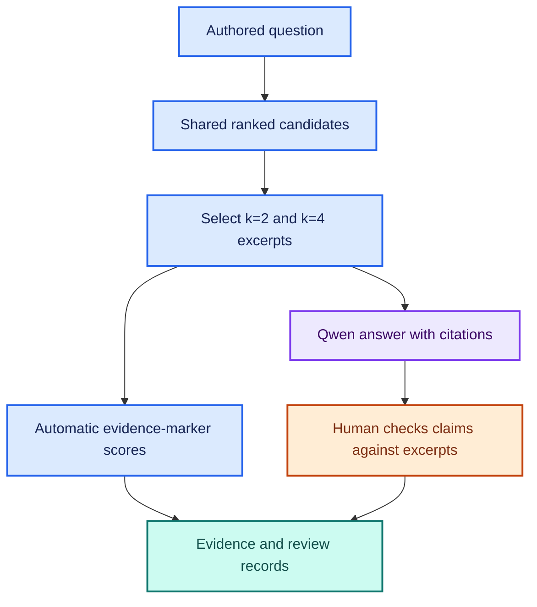

# 📚 Extension 5: Multi-Document Answer Evaluation

**🟩 Three manual examples inspected, with a Birch wording caveat. 🟠 New live capture and review pending.**

The existing agent already combined two documents and two PDF pages in the
user's examples. This extension measures where that behavior stops working.
The interactive prompt, retrieval defaults, and historical experiments remain
the baseline. Run the new lab before deciding on a retrieval or prompt change.

## 🧩 What is measured separately?



| Layer | Method | What it establishes |
| --- | --- | --- |
| 🔎 Retrieved evidence | Source/page/text-marker matching | Which authored evidence groups reached the model |
| 🔗 Citation syntax | Numeric-label bounds check | Whether a label refers to an available excerpt |
| 🟠 Answer quality | Human review of the saved answer and excerpts | Completeness, attribution, actual citation support, and uncertainty |

A correct filename or valid citation label cannot establish factual support.
An answer can have complete retrieved evidence and still misuse it.

## 🗂️ Seven development cases

| Case | Evidence needed | Purpose |
| --- | --- | --- |
| Cedar and Maple | Two notes | All approval conditions and separate citations |
| Atlas approval and failure | Two PDF pages | Correct page attribution |
| Cedar and Birch | Two notes | Specified versus unspecified requirements |
| Cedar, Maple, and Atlas approvals | Three document/page units | Detect insufficient context at k=2 |
| Four build failure causes | Four document/page units | Keep causes attached to the correct builds |
| Cedar and absent Willow | Known plus unavailable information | Answer known part and acknowledge missing evidence |
| Larch conflict control | Two supplied notes | Disclose disagreement without inventing an authoritative policy |

The Larch control lives only in evaluation/multidoc-cases.json. It is never
added to docs/ or the Chroma index. Both notes are supplied directly, once per
run, without k or semantic search. It tests generation under controlled context;
its result must not be pooled into retrieval comparisons.

## 🚀 Run on Windows

Start with validation and the offline suite:

```powershell
git pull --ff-only origin main
python -m unittest discover -s tests -v
python .\eval_multidoc.py --suite all --validate-only
```

Expected: 52 tests and seven valid cases on five document/page units.
Validation reads files and extracts PDF text without embedding, chat, or index calls.

Capture six retrieved cases at k=2 and k=4, plus the one conflict control:

```powershell
python .\eval_multidoc.py --suite all
```

This makes 13 sequential chat calls, so allow several minutes. Qwen and
nomic-embed-text must be installed in local Ollama. Retrieval uses the current
1000-character chunks, 200-character overlap, and ID priority. Each retrieved
question is searched once for the largest k; both contexts use that same ranking.
Every generation is an independent invocation without conversation history.
Call order is fixed, not randomized, and generation may vary even at temperature 0.
This is a diagnostic development comparison, not a controlled efficacy study.

For a shorter first capture:

```powershell
python .\eval_multidoc.py --ks 2
```

The short command selects only the six retrieved cases. It does not establish
a k=2 versus k=4 comparison. The interactive application retains its defaults.

## 💾 Inspect the saved evidence

Each unique verification/multidoc-runs/ directory contains:

| Artifact | Content |
| --- | --- |
| summary.md | Capture status, marker coverage, and structural citation warnings |
| report.json | Exact answers, excerpts, source/page labels, ranking trace, settings, code hashes, package versions, model digests, timing, and errors |
| cases.snapshot.json | Frozen questions, required evidence, expected claims, and review guidance |
| corpus.snapshot.json | Frozen extracted corpus text and page metadata |
| review.json | Initially unreviewed ratings and evidence notes |

The runner checkpoints each answer and preserves failed/interrupted status and
completed records. It does not resume interrupted runs; a new invocation creates
a new directory. The review worksheet is created at the end, including after
a caught failure or interruption. Hard process termination may leave only the
checkpointed report. These files contain the full document text: inspect before
publishing. Current examples are fictional.

## 🟠 Human scoring rubric

Rate each dimension pass/fail. Leave null until inspected; null is never a pass.

| Dimension | Pass | Fail examples |
| --- | --- | --- |
| Completeness | Every expected claim and required condition is addressed correctly | Missing operations lead; omitting Maple security checks |
| Attribution | Facts belong to the correct project/build/release | Giving Maple the Birch disk-space failure |
| Citation support | Every substantive factual claim has supporting cited excerpt(s), with correct PDF page identity | Valid [1] points to an unrelated source; uncited added facts |
| Uncertainty | Missing/conflicting evidence is identified and claims are limited to available excerpts | Inventing Willow policy; claiming Birch intentionally omitted a section; choosing one conflicting note without authority |

Completeness uses the full authored expected answer, not just retrieved evidence.
An answer can correctly acknowledge a retrieval miss and pass uncertainty while
failing completeness. Check unexpected additions as well as expected claims.
For the Larch control, completeness requires both competing policies and an
explicit statement that the available notes do not resolve their authority.

For each reviewed record, add reviewer identity and notes that identify the
answer claim, cited source/page, supporting or contradicting excerpt, and reason
for each failed dimension. Use review.json, then summarize with the actual path:

```powershell
$multiRunPath = ".\verification\multidoc-runs\REPLACE_WITH_RUN_ID"
python .\eval_multidoc.py --summarize-review $multiRunPath
```

The summary reports reviewed and unreviewed counts separately for each dimension.
It does not overwrite the raw capture. Inspect per-case, per-k, and per-suite
ratings before making comparisons; the overall review counts are descriptive.

## ⚠️ Interpretation and next decisions

- These are seven authored, fictional development cases, not held-out research data.
- No new live answers have been measured by the implementation tests.
- Capture completion is not an answer-quality pass.
- A k=4 gain would show evidence of benefit on these cases, not justify a universal default.
- If evidence is missing, investigate context selection; if evidence is present but
  misused, investigate prompt/generation behavior. Preserve the baseline first.
- The current lab uses human ratings, not an LLM judge or automatic semantic grading.

[Manual examples](../verification/multidoc-manual-20261110.md) ·
[Implementation checks](../verification/multidoc-implementation.md) ·
[Case dataset](../evaluation/multidoc-cases.json) ·
[Tutorial acknowledgment](../README.md#tutorial-acknowledgment-and-attribution)
