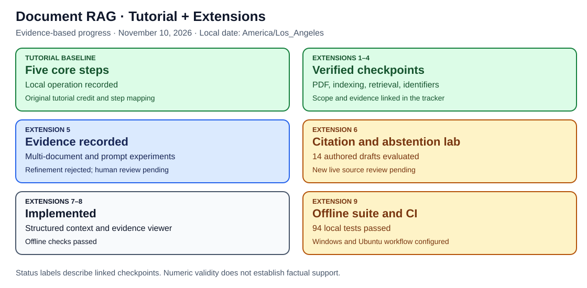
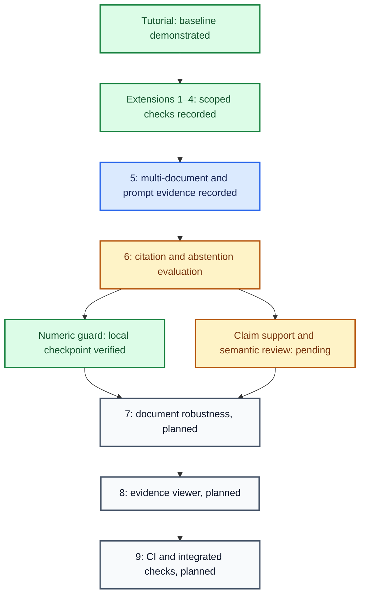

# 🗺️ Tutorial and Extension Progress Tracker

**Project 5: Local Document RAG Q&A Agent · Updated November 10, 2026, America/Los_Angeles**

**🟩 Verified checkpoint · 🟦 Implemented/evidence recorded · 🟠 In progress or review pending · ⬜ Planned · 🔴 Failed/rejected experiment**

This is the central status table for this repository. It tracks implementation,
observed verification, and remaining work separately. A working example, a passed
software test, an assistant judgment, and independent human validation are different
kinds of evidence. The current work is **Extension 6**, not another Extension 5
prompt revision. Planned extensions are listed without implying their code exists.

## 📚 Part A: Base tutorial

Foundation: [Darsh Shah's freeCodeCamp tutorial](https://www.freecodecamp.org/news/build-a-private-rag-qa-ai-agent-for-your-documents-using-langchain/),
published July 2, 2026. The five numbered source steps were checked against the
article. The repository adapts the implementation rather than claiming a verbatim
copy. Its learning architecture is [documented here](../README.md#architecture).

| Source tutorial step | Repository work | Current status | Evidence | Remaining work |
| --- | --- | --- | --- | --- |
| 1. Install Ollama and pull the models | Local Qwen and nomic-embed-text | 🟩 Operating locally | [Saved model identities](../verification/citation-guard-runs/20261111T011524Z-f2bde230/report.json); [initial checks](../verification/initial-results.md) | No blocker for the baseline checkpoint |
| 2. Install Python dependencies | Windows virtual environment and project packages | 🟩 Tested local environment | [Requirements](../requirements.txt); [runtime package records](../verification/multidoc-runs/20261110T222813Z-bc04d7e8/report.json) | New 89-test Windows output still to record; earlier 72 passed |
| 3. Prepare documents | Fictional Markdown notes and text-extractable Atlas PDF | 🟩 Fixture corpus exercised | [Tracked documents](../docs/); [PDF record](../verification/pdf-results.md) | No blocker for the authored fixture checkpoint |
| 4. Q&A agent Python code | Load, chunk, embed, persist, retrieve, supply middleware context, answer and display sources | 🟩 Adapted core implemented and exercised | [Agent code](../qa_agent.py); [initial checks](../verification/initial-results.md); [source audit](../verification/retrieval-run-audit-20261110.md) | Broader answer quality belongs to extension evaluation |
| 5. Run the agent | Interactive questions, answers, source labels, index reuse | 🟩 Baseline demonstrated | [Initial results](../verification/initial-results.md); [interactive Maple](../verification/identifier-interactive-20261110.md); [multi-document examples](../verification/multidoc-manual-20261110.md) | Guarded interactive example remains an Extension 6 check |

**Baseline checkpoint:** the tutorial-derived local pipeline is implemented and
has recorded local operation. The examples use this repository's fictional
fixtures, not the tutorial author's document corpus. Conceptual explanations and
diagrams are references, not an assessment of the learner's understanding.

## 🛠️ Part B: Repository extensions

| # | Extension | Implemented / preserved on GitHub | Verified checkpoint | Remaining work |
| --- | --- | --- | --- | --- |
| **1 📄** | PDF verification and page citations | [Page-preserving loader](../qa_agent.py), [PDF guide](../guides/VISUAL_GUIDE.md) | 🟩 Three recorded PDF smoke checks | Defined initial checkpoint done; broader PDF coverage is outside that claim |
| **2 🔄** | Automatic index updates | [Fingerprint-based startup indexing](../qa_agent.py) | 🟩 [Add/edit/remove/reuse checks](../verification/index-refresh-results.md) | Defined startup-refresh checkpoint done |
| **3 🧪** | Retrieval Evaluation Lab | [Runner](../eval_retrieval.py), [cases](../evaluation/cases.json), [tests](../tests/test_retrieval_lab.py) | 🟩 [Six-setting run](../verification/retrieval-runs/20261110T184155Z-a94eff34/summary.md) and [audit](../verification/retrieval-run-audit-20261110.md) | Authored-fixture checkpoint done; no claim of general retrieval accuracy |
| **4 🔎** | Exact-ID and semantic retrieval | [Retriever](../id_retrieval.py), [paired runner](../eval_id_retrieval.py) | 🟩 [Paired audit](../verification/identifier-run-audit-20261110.md) and [interactive Maple](../verification/identifier-interactive-20261110.md) | Defined ranking/interactive checkpoint done |
| **5 📚** | Multi-document answers | [Answer lab](../eval_multidoc.py), [prompt comparisons](../eval_prompt_comparison.py), raw snapshots, assistant reviews, and negative results | 🟦 Captures/audits recorded; 🔴 second prompt refinement rejected | Independent human ratings remain pending; preserve the rejection, do not equate more instructions with better answers |
| **6 🔗 CURRENT** | Citation and abstention evaluation | [Numeric guard](../citation_guard.py), [replay/live evaluator](../eval_citation_guard.py), [runtime flag](CITATION_GUARD.md) | 🟩 [Two live retry outcomes audited](../verification/citation-guard-live-audit-20261110.md): one withheld, one numeric pass with unsupported citation | 🟠 Claim-to-source support and semantic-abstention evaluation; guarded interactive check; independent human review; Windows 89-test output |
| **7 🛡️** | Document-instruction robustness | ⬜ Planned; current prompt treats excerpts as data | No adversarial-document evaluation recorded | Create hostile-document cases; test instruction handling, source isolation, and bounded behavior |
| **8 🖥️** | Interactive evidence viewer | ⬜ Planned; current CLI prints sources | No dedicated viewer recorded | Show retrieved excerpts, source/page identity, and links between claims and evidence |
| **9 ⚙️** | Automated tests and CI | 🟦 [Tests](../tests/) are already added incrementally; 89 pass in development | Earlier 72-test Windows run observed; no GitHub workflow exists at this checkpoint | Record current local suite; add CI and inspect its actual run; complete integrated checks |

The extension sequence comes from this learning project. It is separate from
the tutorial author's five steps and from the overall AI-project roadmap where
Project 6 is LangSmith tracing. Tests are added during earlier extensions; the
final CI extension does not postpone testing until the end.

## 🎨 Progress and evidence flow

Arrows show the intended progression, not an automatic deployment or completion
claim. Extension 5's human review remains pending alongside the current work.

## 📋 Part C: Current next actions

| Priority | Action | Evidence needed to update status |
| --- | --- | --- |
| 1 | Reproduce the current suite and guard audit locally | 89-test output; 39 records/41 attempt checks reproduced |
| 2 | Finish Extension 6's factual-support/abstention evaluation | Claim/excerpt judgments and distinct outcomes for missing evidence, unnecessary refusal, conflict, and numeric withholding |
| 3 | Move into Extension 7, then 8 and 9 | New implementation, tests, and recorded results for each; keep future items planned until observed |

The live guard accepted a Willow repair citing Birch [4]. That result is **not
factually verified** and stays visible in [the audit](../verification/citation-guard-live-audit-20261110.md).
The refined prompt's failed experiment and all original source runs are retained.

## 🔬 Verification labels and maintenance

- **Implemented** means code exists; **verified checkpoint** means the linked
  observation passed its stated scope. Neither means universal reliability.
- **Assistant review** is explicitly AI-assisted. Independent human ratings are
  still pending and must never be inferred from a completed capture.
- The user supplied a Windows run of 72 tests, all passing, at c581f3d. The later
  89-test suite passed in development; its Windows test output has not been supplied.
- No completion percentage is invented from rows or file counts. Different tasks
  have different size, and future scope may evolve.
- Update this tracker with each implementation/verification commit. Keep the
  README entry point, roadmap, and verification dashboard consistent with it.

This follows the [shared project documentation standard](../PROJECT_STANDARD.md),
building on [Project 1's versioned baseline/extension layout](https://github.com/anne500/multi-agent-study-guide).

[Detailed verification dashboard](../verification/DASHBOARD.md) ·
[Extension roadmap](EXTENSION_ROADMAP.md) ·
[Tutorial credit](../README.md#tutorial-acknowledgment-and-attribution)
