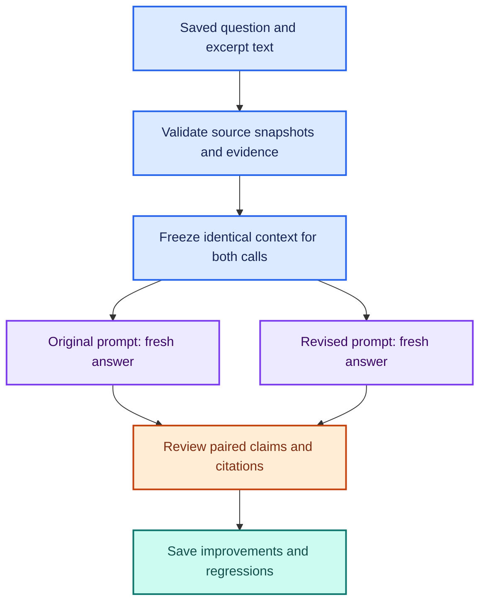

# 🧪 Frozen-Context Prompt Comparison

**🟩 65 offline tests passed in development; first paired capture audited. 🟠 Independent human review pending.**

This follows [Extension 5's first answer audit](../verification/multidoc-run-audit-20261110.md).
More context recovered missing facts, but the model still added unsupported
Birch claims. This experiment changes the instructions while keeping each
pair's question and exact labeled excerpts fixed.

## 🧩 Experiment design



| Kept fixed within each pair | Deliberately varied |
| --- | --- |
| Question, excerpt order, source/page labels, complete excerpt text | Original versus revised system prompt |
| Chat model, temperature 0, reasoning disabled | Which prompt runs first alternates by selected source record |
| Independent calls with no conversation history | One new answer per prompt |

Both answers are generated afresh in the same run. The old captured answers
are preserved in the source snapshot for provenance; they are not used as the
new experimental baseline. Neither prompt receives expected answers, ratings,
or the other prompt's output.

The baseline prompt is read verbatim from the saved source report. The revised
prompt appends generic rules to it, without project names or expected answers.
The existing agent factory accepts an explicit prompt; its default remains
the unchanged interactive prompt. No retrieval, embeddings, PDF reading,
index rebuild, or Chroma search occurs in this comparison. Importing the
agent still requires the project's installed packages.

## 📝 What the revised prompt tests

| Rule | Failure it targets |
| --- | --- |
| Address each requested entity and keep its facts separate | Missing conditions or misattributed requirements |
| Make only excerpt-supported claims | Unsupported additional operational rules |
| Distinguish advice from enforced requirements | Turning recovery guidance into a prohibition |
| Bound missing information to retrieved excerpts | Inferring real-world or corpus-wide absence |
| Do not infer an intentional omission | Unsupported explanation for missing documentation |
| Cite supporting facts; treat missing context as a limitation | Using an unrelated document as evidence about an absent project |
| Describe unresolved conflict without inventing authority | Selecting a policy or combining incompatible requirements |
| Omit unrequested facts | Unnecessary additions that create more opportunities for error |

These rules are motivated by the already-inspected development cases. A positive
result would be evidence on those cases, not a held-out generalization result.

## 🚀 Run on Windows

```powershell
git pull --ff-only origin main
python -m unittest discover -s tests -v
python .\eval_prompt_comparison.py --validate-only
```

Expected: **65 passing tests**, then **13 frozen source records and 13 selected
pairs (26 new chat calls)**. Validation makes no model or index calls.
The default source is verification/multidoc-runs/20261110T222813Z-bc04d7e8.

Run the full comparison:

```powershell
python .\eval_prompt_comparison.py
```

This makes 26 sequential local Qwen calls and may take several minutes.
It covers the six retrieved questions at both k settings plus the conflict
control, with both prompts. A prompt cannot recover facts excluded from an
excerpt set; the k=2 evidence shortages remain useful abstention tests.

For a shorter initial run limited to Birch and Willow:

```powershell
python .\eval_prompt_comparison.py --case-ids cedar_birch_missing known_unknown
```

That selects four contexts and makes eight calls. It omits broader-completeness
and conflict regression checks; document that reduced scope if using it.
Unknown or uncaptured case IDs are rejected. An alternative complete source
capture can be selected with --source-run PATH.

## 💾 Saved artifacts

Each invocation creates a unique verification/prompt-runs/ directory.

| File | Evidence |
| --- | --- |
| report.json | Fresh answers, exact context text and hashes, prompts, call order, model identity, model-name consistency, package versions, code hashes, timings, and errors |
| source-report.snapshot.json | Frozen original capture, including original answers and provenance |
| cases.snapshot.json and corpus.snapshot.json | Source questions, review criteria, and corpus text |
| prompts.json | Exact original and revised system prompts |
| review.json | Separate, initially null ratings for every completed variant |
| summary.md | Pair capture status; answer quality remains unreviewed |

Report context/prompt hashes use canonical JSON SHA-256, like the prior lab;
code hashes use raw file bytes. Model digests are checked at the beginning
and end. The report records whether the current chat-model digest matches
the older source capture. A different old digest does not invalidate the new
within-run pairing, but it prevents assuming the old and new answers had
identical model versions. A digest change during the new run fails the run.

Every answer is checkpointed. A failed/interrupted variant preserves earlier
answers and the frozen context. A rerun creates a new directory, not a resumed
or overwritten experiment. Review worksheets include only completed calls;
partial captures must retain their failed/interrupted status.

The reports include full source text; the default fixture corpus is fictional.

## 🔗 Citation syntax versus citation support

This runner's version-2 syntax check recognizes both [1] and [1, 2], including
multiple adjacent labels. It reports out-of-range numeric labels. It is limited
to those numeric formats; it does not validate every citation convention or
decide whether a cited excerpt actually supports a claim. It can also encounter
numeric brackets used for other purposes. Check interpretation in review.

The original multi-document parser, saved reports, and reproduction audit
remain unchanged. The new parser is confined to the new comparison.

## 🟠 Review and interpretation

Use the [four-dimension rubric](MULTIDOC_EVALUATION.md#-human-scoring-rubric):
completeness, attribution, citation support, and uncertainty. Record exact
claim/excerpt reasons for each proposed failure. Keep unreviewed ratings null.
Any assistant-generated review must be labeled separately from human ratings.

For each frozen context, compare both answers, not just the revised one.
Preserve regressions, new unsupported additions, and correct abstentions.
Keep the k=2 and k=4 contexts identifiable and the direct conflict control
separate from retrieved-context results. No automatic winner is assigned.

Alternating order reduces a simple always-baseline-first bias, but this is one
generation per prompt/context with no randomization or repetitions. Temperature
0 does not guarantee deterministic output. Cache effects, service state, and
sampling variation remain possible. Timing is descriptive, not a latency
benchmark. Independent human review and new held-out cases remain future work.

[Implementation checks](../verification/prompt-comparison-implementation.md) ·
[Prior source audit](../verification/multidoc-run-audit-20261110.md) ·
[Tutorial acknowledgment](../README.md#tutorial-acknowledgment-and-attribution)


## 📊 First Paired Capture Follow-up

The [November 10 audit](../verification/prompt-run-audit-20261110.md) checks
all 13 pairs and 26 answers, including exact context/prompt hashes and numeric
citation results. The proposed assistant review records two Birch citation-support
improvements, unchanged expected-answer completeness, and no four-dimension
pass/fail regressions. Willow's k=2 citation-scope defect remains. New scope
concerns in the three-project k=2 answer and unrequested details are documented
without adding a new scored dimension after inspecting outputs.

Keep the revised prompt experimental while these issues are addressed.
Assistant-review artifacts are separate from the unchanged, unreviewed human
worksheet. The original raw capture files and interactive prompt are preserved.
