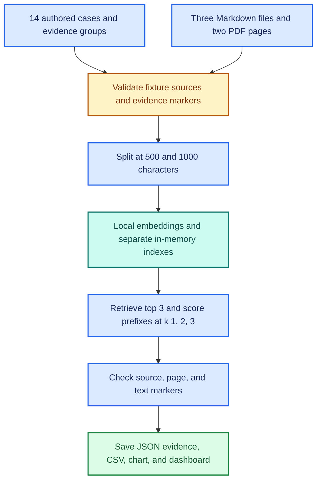

# 🧪 Retrieval Evaluation Lab

**🟦 Learn retrieval · 🟩 Preserve evidence · 🟪 Build research methods · 🟠 Live run pending**

This extension evaluates retrieval without asking the chat model to answer.
It reuses the application's document loader, creates separate in-memory Chroma
collections, and leaves the interactive agent's index and constants unchanged.

## 🧩 Evaluation architecture



## 🗂️ What is included

| File | Role |
| --- | --- |
| [evaluation/cases.json](../evaluation/cases.json) | Questions and authored expected evidence |
| [retrieval_metrics.py](../retrieval_metrics.py) | Dependency-free evidence matching and scoring |
| [eval_retrieval.py](../eval_retrieval.py) | Local experiment runner and report generation |
| [tests/test_retrieval_lab.py](../tests/test_retrieval_lab.py) | Offline scorer and mocked-runner checks |
| [Implementation verification](../verification/retrieval-lab-implementation.md) | Verified software behavior and remaining checks |

## 🧭 Case coverage

| Cases | Count | Expected evidence |
| --- | ---: | --- |
| Cedar failure, approval, recovery | 3 | Specific Cedar passages |
| Maple direct and misleading failure questions | 2 | Expired signing certificate |
| Birch disk space and unspecified approval | 2 | Disk requirement or explicit absence of approval policy |
| Atlas approval, recovery, cross-page question, unspecified date | 4 | Specific PDF pages and supporting passages |
| Cedar/Maple approval comparison | 1 | Both project policies |
| Absent Willow and Neptune facts | 2 | No authored evidence; unscored controls |

The lab requires the four published fixture files and five document/page units.
It stops before embedding if sources or required evidence are missing.
Remove the temporary Willow test file before running.

## 🚀 Run on Windows PowerShell

Use the project's existing virtual environment and pinned requirements.
No additional package is required.

```powershell
python -m unittest discover -s tests -v
python .\eval_retrieval.py --validate-only
python .\eval_retrieval.py
```

Ollama must be running for the full evaluation, with nomic-embed-text installed.
Validation-only mode calls the loader but does not call Ollama or write indexes.
The full run uses the local embedding model; it does not invoke Qwen.

Defaults compare six combinations:

| Chunk size | Overlap | Retrieval prefixes |
| ---: | ---: | --- |
| 500 characters | 200 characters | k=1, 2, 3 |
| 1000 characters | 200 characters | k=1, 2, 3 |

One top-3 search per question and chunk size supplies all three prefixes.
This keeps the k comparisons within a shared ranked list.
Ties, embedding behavior, and environment changes can still affect reruns.

## 📊 Metrics: what the dashboard means

An evidence group names a source, a PDF page where applicable, and text markers.
A chunk matches only if its source and page match and it contains every marker
in that group. Matching ignores case and collapses whitespace.

| Metric | Per-question calculation | Interpretation |
| --- | --- | --- |
| Hit@k | 1 if any required group is found, otherwise 0 | Some supporting evidence was retrieved |
| Complete@k | 1 if every required group is found, otherwise 0 | All authored evidence requirements were covered |
| Coverage@k | Distinct matched groups / required groups | Fraction of required evidence recovered |
| MRR@k | 1 / rank of first matching chunk, or 0 | How early supporting evidence appeared |
| Precision@k | Matching chunks / actual returned chunks | Fraction of retrieved chunks matching an authored group |

Each metric is averaged over the 12 evidence cases. A PDF page or document is
not enough by itself: the chunk must also match the required markers.
Repeated overlapping chunks cannot increase distinct-group coverage, although
each matching chunk contributes to chunk precision.

The two no-evidence controls receive null relevance metrics and are excluded
from averages. A retriever still returns nearby chunks for those questions.
This lab does not test whether an answer generator abstains correctly.

## 🎨 Generated results dashboard

Each invocation creates a new folder:

    verification/retrieval-runs/<UTC timestamp>-<unique suffix>/

| Artifact | Contents |
| --- | --- |
| summary.md | GitHub-readable dashboard, chart, and metric table |
| retrieval-results.svg | Blue coverage, green completeness, and purple MRR bars |
| metrics.csv | All five aggregate metrics for the six settings |
| report.json | Per-case ranks, full retrieved text, pages, distances, marker matches, timings, and run status |
| cases.snapshot.json | Exact authored dataset used |
| corpus.snapshot.json | Exact extracted fixture content used |

The report records embedding model name and digest, package versions, platform,
Python, Git commit when available, and hashes of the corpus, cases, and code.
Chroma distances are raw retrieval distances, not calibrated confidence scores.
The embedding digest is checked again at the end.

Progress is saved after each case. Completed, failed, and interrupted runs
are labeled separately. Only fully completed chunk configurations contribute
aggregate rows; partial case evidence remains available in report.json.

## 🟩 Publish observed results to GitHub

Generated runs are stored under verification/ so they can be committed.
They are not automatically pushed. Review the report's status and evidence,
then commit the selected run directory and update the dashboard with its link.

Do not label the local embedding run verified until its output has been inspected.
The implementation record's offline checks are not model-performance results.

## ⚠️ Interpretation limits

- Four fictional files and authored development questions are not a held-out benchmark.
- Text markers are a mechanical relevance proxy, not semantic entailment.
- Paraphrases may be missed, and a negated marker can still match.
- Chunk size changes the available passages and the number of chunks.
- Multi-source questions need Complete@k and Coverage@k, not Hit@k alone.
- A better retrieval score does not prove a better final answer or valid citations.
- There is no threshold-based no-answer detection or automatic setting recommendation.
- Timings are single-run observations. Shared top-3 timings cannot compare k latency.
- No real-build BRI dataset, statistical significance, or thesis result is claimed.

## 🟪 Learning, portfolio, and research connection

| Learning | Portfolio evidence | Potential research use |
| --- | --- | --- |
| Distinguish retrieval from generation | Runnable experiment and inspectable failures | Separate evidence availability from diagnosis quality |
| Track source identity and PDF pages | Per-case ranked passages | Audit evidence provenance |
| Compare settings on fixed questions | CSV, colored chart, and dashboard | Develop a protocol before collecting held-out BRI cases |

## 📚 Tutorial acknowledgment

The application foundation is Darsh Shah's freeCodeCamp tutorial,
[How to Build a RAG Q&A AI Agent for Your Documents Using LangChain v1](https://www.freecodecamp.org/news/build-a-private-rag-qa-ai-agent-for-your-documents-using-langchain).
The authored cases, scoring rules, experiment runner, offline tests, and
evaluation dashboard are repository-specific learning extensions.

Implementation references:
[LangChain Chroma integration](https://docs.langchain.com/oss/python/integrations/vectorstores/chroma)
and [Ollama model identity endpoint](https://docs.ollama.com/api/tags).
