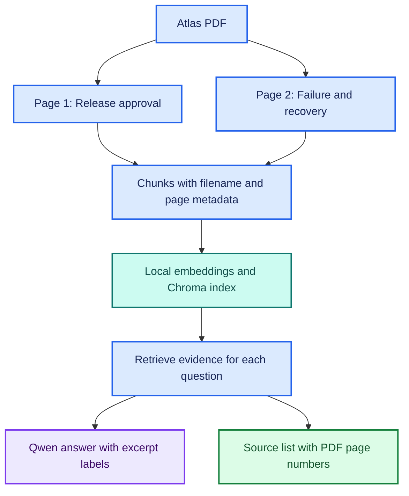
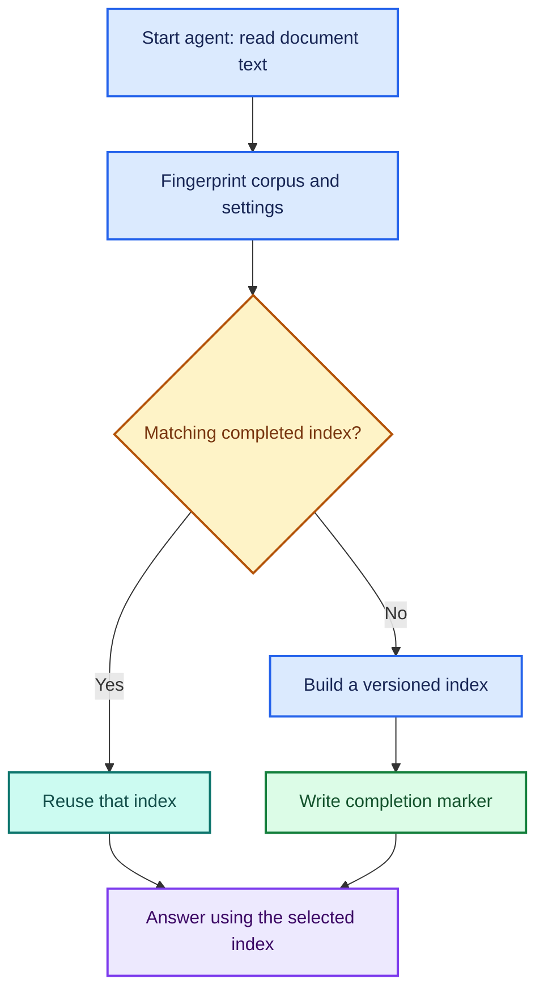
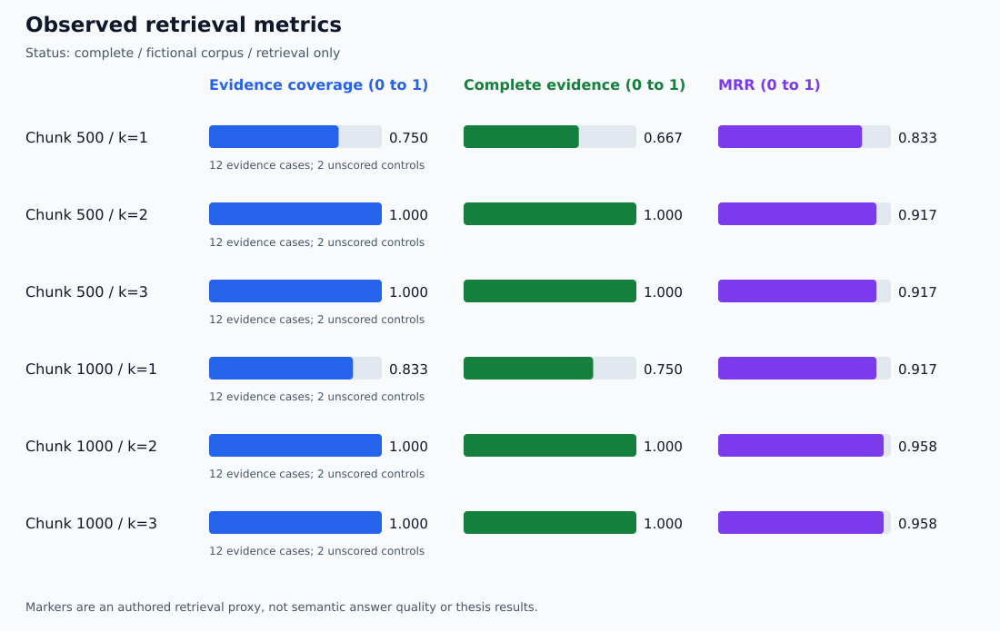
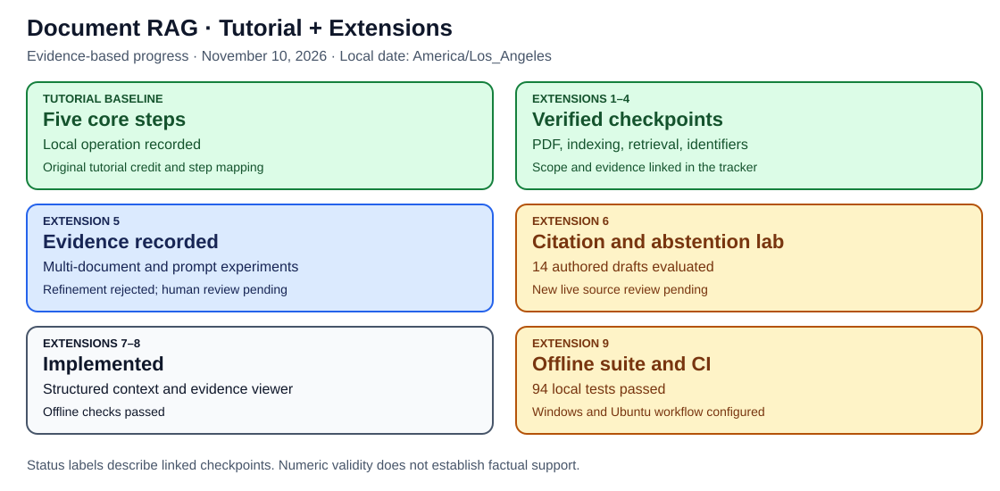

# 🎨 Document RAG: Visual Guide

🟦 Learning · 🟩 Verified behavior · 🟪 Research connection · 🟠 Pending work

## 🗺️ How PDF evidence reaches an answer

## 🔎 Reading a citation

| Display | Meaning |
| --- | --- |
| Answer includes [1] | The model points to retrieved excerpt 1 |
| Source [1] names Atlas PDF, page 2 | That excerpt came from PDF page 2 |
| Reviewer checks page 2 | Confirms whether it supports the answer |

Excerpt labels are assigned separately for each question.
[1] is not a permanent document or page identifier.

## 🧪 Verification dashboard

| Capability | Status | Evidence |
| --- | --- | --- |
| Local embeddings | 🟩 Observed | 768-dimensional vector |
| Saved-index reuse | 🟩 Observed | Index reopened successfully |
| Direct project retrieval | 🟩 Observed | Cedar, Maple, and Birch |
| Missing-information handling | 🟩 Observed | Selected Markdown and PDF questions |
| PDF page citations | 🟩 Observed | Three Atlas smoke checks |
| Retrieval Evaluation Lab | 🟩 First local run audited; 22 development tests | [Measured results](../verification/retrieval-runs/20261110T184155Z-a94eff34/summary.md) |
| Identifier-aware retrieval | 🟩 Paired run audited; one interactive answer checked | [Measured comparison](../verification/identifier-runs/20261110T200859Z-0651f827/summary.md); [manual check](../verification/identifier-interactive-20261110.md) |
| Automatic index updates | 🟩 Startup add, edit, removal, and reuse checks passed | [Index-refresh record](../verification/index-refresh-results.md) |
| Scanned PDFs and OCR | 🟠 Pending | Not implemented |
| Document-instruction robustness | 🟠 Pending | Not evaluated |

## 🔬 Retrieval experiment

| Setting | Evidence | Outcome |
| --- | --- | --- |
| k=1 | Birch | Missing Maple evidence; agent abstained |
| k=2 | Birch and Maple | Corrected the misleading Maple premise |

This is one observed improvement, not a general performance claim.

## 🟪 Research connection

Evaluate these separately:

1. Did retrieval find the necessary evidence?
2. Did the answer faithfully use that evidence?
3. Does each citation support its associated claim?

See the [initial results](../verification/initial-results.md) and
[PDF results](../verification/pdf-results.md).

## ?? Automatic Startup Refresh

?? Observed: unchanged restart, document addition, edit, and removal.

?? Scope: startup checks, complete-corpus rebuilds, historical index retention.
This does not implement live watching, incremental embedding, or secure erasure.

See the [refresh results](../verification/index-refresh-results.md).

## 📋 Complete Verification Dashboard

See the [repository verification dashboard](../verification/DASHBOARD.md) for
the tutorial baseline, extensions, preserved failures, and pending local checks.
The [colored evaluation guide](RETRIEVAL_LAB.md) explains the experiment flow
and the generated results dashboard.

## 📊 Measured Retrieval Results

See the [evidence audit](../verification/retrieval-run-audit-20261110.md) for
the Maple retrieval miss, Atlas page coverage, and the limits of these scores.

## 🔎 Whole-ID Retrieval Extension

See the [colored architecture and paired-evaluation guide](IDENTIFIER_RETRIEVAL.md)
for exact identifier matching, semantic fallback, unknown IDs, and regression checks.
The semantic-only measurements above remain the historical baseline.

## 🟣 Measured Identifier-Priority Comparison

Maple moved from rank 2 to rank 1 in both chunk configurations.
The [audit](../verification/identifier-run-audit-20261110.md) checks the paired
rankings and records limitations; answer quality remains a separate check.

## 📚 Multi-Document Answers and Review

The [Extension 5 workflow and rubric](MULTIDOC_EVALUATION.md) separates automatic
marker coverage, citation-label checks, and human answer-quality ratings.
Three [manual examples](../verification/multidoc-manual-20261110.md) were inspected;
the Birch answer has a wording caveat. The first expanded live capture is now audited.
The lab tests k=2 versus k=4 on shared ranked candidates and handles conflicting
notes in a separate direct-context control. Unreviewed answers stay unscored.

[📊 Expanded capture audit and assistant review](../verification/multidoc-run-audit-20261110.md):
k=4 recovered the missing evidence for both broader questions; unsupported
Birch wording remained. Proposed source-review ratings are AI-assisted and
human confirmation remains pending. The original capture dashboard is preserved.

## 🧪 Frozen-Context Prompt Follow-up

The [comparison workflow](PROMPT_COMPARISON.md) branches each saved question
and exact context into original and revised prompt calls, then compares their
claims. All 65 offline checks pass in development; the first paired capture is now audited.
New numeric syntax checks handle [1, 2] without claiming semantic citation support.

The [first prompt audit](../verification/prompt-run-audit-20261110.md) checks
13 pairs and 26 answers. Proposed assistant citation-support ratings improve
for both Birch contexts; Willow k=2 remains problematic. Qualitative scope
caveats are preserved separately from the four-dimension rubric. Human review
is pending, and the interactive prompt remains the original default.

## 🧪 Three-Prompt Refinement

The [second-refinement guide](PROMPT_REFINEMENT.md) compares baseline, revised,
and refined answers on identical saved contexts. A cyclic call-order table
shows which variant runs first. All 72 development tests pass; the first refined capture is now audited.
Previous measurements remain separate.

The [refinement audit](../verification/prompt-refinement-run-audit-20261110.md)
preserves a negative result: two invented [7] citations and additional unsupported
claims. The refinement is rejected for adoption. The saved data is consistent;
that does not make its answers correct. AI-proposed ratings and human-review
status remain separate.

## 🔗 Extension 6: Citation Guard

The [guard diagram and evaluation guide](CITATION_GUARD.md) shows the numeric
check, one retry, and withholding branch. Saved [7] failures are replayed;
live repair requires only two new model calls. The [extension roadmap](EXTENSION_ROADMAP.md)
keeps robustness, the viewer, and CI as Extensions 7–9. Numeric validity is not
factual support, and Extension 6's broader semantic evaluation remains pending.

## 🗺️ Tutorial and Extension Tracker

The [central tracker](PROJECT_TRACKER.md) separates five tutorial steps from
all nine extensions, with colored labels, evidence links, remaining tasks,
and a compact progression diagram. The [shared standard](../PROJECT_STANDARD.md)
uses the same tutorial-baseline-plus-extensions pattern as Project 1.

The [live guard audit](../verification/citation-guard-live-audit-20261110.md)
records one withheld retry and one numeric pass whose citation support still
fails. The closeout adds the answer evidence lab, structured context, HTML viewer, and CI.
[Open the closeout guide](PROJECT_FINISH.md).
