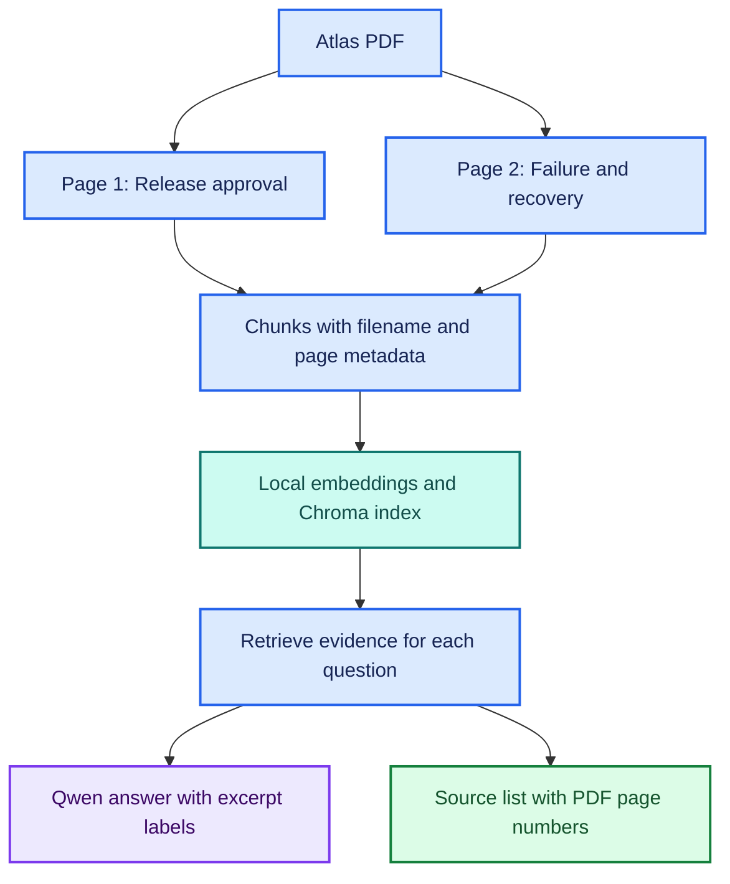
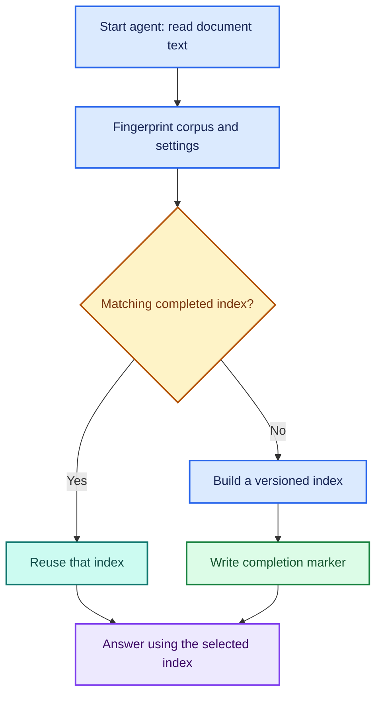

# 🎨 Document RAG: Visual Guide

🟦 Learning · 🟩 Verified behavior · 🟪 Research connection · 🟠 Pending work

## 🗺️ How PDF evidence reaches an answer

## 🔎 Reading a citation

| Display | Meaning |
| --- | --- |
| Answer includes [1] | The model points to retrieved excerpt 1 |
| Source [1] names Atlas PDF, page 2 | That excerpt came from PDF page 2 |
| Reviewer checks page 2 | Confirms whether it supports the answer |

Excerpt labels are assigned separately for each question.
[1] is not a permanent document or page identifier.

## 🧪 Verification dashboard

| Capability | Status | Evidence |
| --- | --- | --- |
| Local embeddings | 🟩 Observed | 768-dimensional vector |
| Saved-index reuse | 🟩 Observed | Index reopened successfully |
| Direct project retrieval | 🟩 Observed | Cedar, Maple, and Birch |
| Missing-information handling | 🟩 Observed | Selected Markdown and PDF questions |
| PDF page citations | 🟩 Observed | Three Atlas smoke checks |
| Retrieval Evaluation Lab | 🟩 First local run audited; 22 development tests | [Measured results](../verification/retrieval-runs/20261110T184155Z-a94eff34/summary.md) |
| Automatic index updates | 🟠 Pending | Manual rebuild currently required |
| Scanned PDFs and OCR | 🟠 Pending | Not implemented |
| Document-instruction robustness | 🟠 Pending | Not evaluated |

## 🔬 Retrieval experiment

| Setting | Evidence | Outcome |
| --- | --- | --- |
| k=1 | Birch | Missing Maple evidence; agent abstained |
| k=2 | Birch and Maple | Corrected the misleading Maple premise |

This is one observed improvement, not a general performance claim.

## 🟪 Research connection

Evaluate these separately:

1. Did retrieval find the necessary evidence?
2. Did the answer faithfully use that evidence?
3. Does each citation support its associated claim?

See the [initial results](../verification/initial-results.md) and
[PDF results](../verification/pdf-results.md).

## ?? Automatic Startup Refresh

?? Observed: unchanged restart, document addition, edit, and removal.

?? Scope: startup checks, complete-corpus rebuilds, historical index retention.
This does not implement live watching, incremental embedding, or secure erasure.

See the [refresh results](../verification/index-refresh-results.md).

## 📋 Complete Verification Dashboard

See the [repository verification dashboard](../verification/DASHBOARD.md) for
the tutorial baseline, extensions, preserved failures, and pending local checks.
The [colored evaluation guide](RETRIEVAL_LAB.md) explains the experiment flow
and the generated results dashboard.

## 📊 Measured Retrieval Results

See the [evidence audit](../verification/retrieval-run-audit-20261110.md) for
the Maple retrieval miss, Atlas page coverage, and the limits of these scores.
