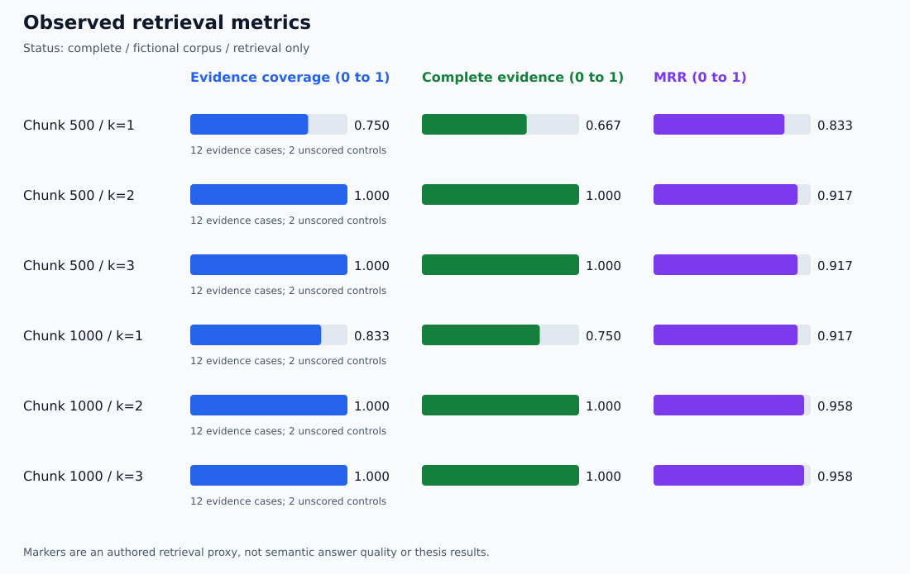
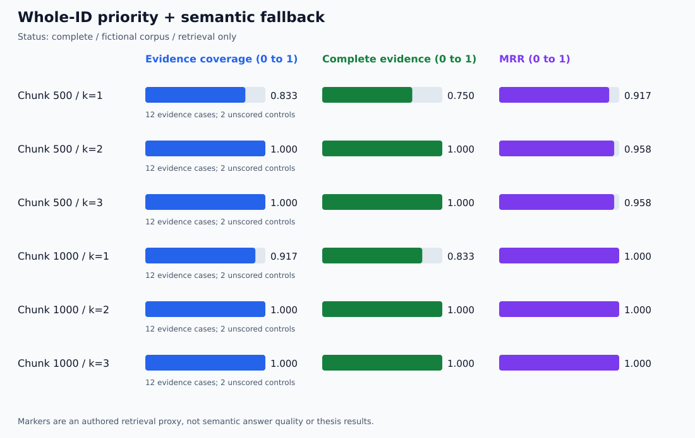

# 📋 Verification Dashboard

**🟩 Observed or checked · 🟠 Pending · 🔴 Preserved failure**

This is the repository's verification index. Status describes the cited checks,
not universal reliability or completion of a thesis experiment.

## 🧱 Tutorial foundation and extensions

| Stage | Status | Evidence |
| --- | --- | --- |
| 📚 Tutorial-based local RAG baseline | 🟩 Manual checks recorded | [Initial results](initial-results.md); [first implementation](https://github.com/anne500/document-rag-qa-agent/tree/32a4847) |
| 🔎 Multiple-document selection | 🟩 Three direct examples passed | [Initial results](initial-results.md) |
| 🧪 Misleading Maple question at k=1 | 🔴 Supporting Maple evidence was missed | [Preserved comparison](initial-results.md) |
| 🧪 Same Maple question at k=2 | 🟩 Evidence retrieved and answer corrected in one run | [Preserved comparison](initial-results.md) |
| 📄 Extension 1: PDF pages and citations | 🟩 Three manual smoke checks passed | [PDF results](pdf-results.md) |
| 🔄 Extension 2: startup index refresh | 🟩 Add, edit, remove, and reuse checks passed | [Index-refresh results](index-refresh-results.md) |
| 🧪 Extension 3: evaluation implementation | 🟩 22 Windows tests passed, including CSV fix | [Implementation verification](retrieval-lab-implementation.md) |
| 📊 Extension 3: local embedding evaluation | 🟩 Completed; all saved scores recomputed | [Measured dashboard](retrieval-runs/20261110T184155Z-a94eff34/summary.md); [audit](retrieval-run-audit-20261110.md) |
| 🔌 Live Chroma/Ollama integration for the lab | 🟩 One Windows run inspected | 28 query records; six aggregate settings; [report](retrieval-runs/20261110T184155Z-a94eff34/report.json) |
| 🔎 Extension 4: identifier-aware implementation | 🟩 41 offline tests passed in development | [Implementation checks](id-retrieval-implementation.md) |
| 📊 Extension 4: paired local evaluation | 🟩 Completed and audited | [Paired dashboard](identifier-runs/20261110T200859Z-0651f827/summary.md); [audit](identifier-run-audit-20261110.md) |
| 💬 Extension 4: interactive answer and citations | 🟩 One misleading Maple example passed | [Transcript and citation inspection](identifier-interactive-20261110.md); semantic remains the default |
| 📚 Extension 5: manual multi-document answers | 🟩 Three inspected; Birch wording caveat | [Observed answers](multidoc-manual-20261110.md) |
| 🧪 Extension 5: capture and review implementation | 🟩 52 offline tests in development; live capture completed; 🟠 Windows test output not supplied | [Checks](multidoc-implementation.md); [guide](../guides/MULTIDOC_EVALUATION.md) |
| 📊 Extension 5: first 13-answer capture | 🟩 Artifact checks passed; assistant review recorded; 🟠 human ratings pending | [Audit and proposed ratings](multidoc-run-audit-20261110.md); [raw capture](multidoc-runs/20261110T222813Z-bc04d7e8/summary.md) |
| 🧪 Extension 5 follow-up: frozen-context prompt comparison | 🟩 65 offline tests in development; paired capture audited; 🟠 Windows test output and independent human ratings pending | [Checks](prompt-comparison-implementation.md); [design](../guides/PROMPT_COMPARISON.md) |
| 📊 Extension 5 follow-up: first prompt capture | 🟩 13 pairs audited; AI source review recorded; 🟠 human confirmation pending | [Audit and adoption recommendation](prompt-run-audit-20261110.md) |
| 🧪 Extension 5 follow-up: second prompt refinement | 🟩 72 offline tests in development; old-run audit compatible; 🟠 Windows/live refined effects pending | [Checks](prompt-refinement-implementation.md); [three-prompt design](../guides/PROMPT_REFINEMENT.md) |
| 🛡️ Retrieved-document instruction robustness | 🟠 Not evaluated | Future extension |

## 🎨 Where the measured-results dashboard appears

The runner creates a unique directory under verification/retrieval-runs/.
Open its summary.md to see the metric table and colored chart.
The same directory contains JSON, CSV, case snapshots, and corpus snapshots.

First inspected local run: [20261110T184155Z-a94eff34](retrieval-runs/20261110T184155Z-a94eff34/summary.md).

Both chunk sizes reached complete marker coverage at k=2 on the 12 evidence
cases. Increasing to k=3 added no coverage. See the [audit](retrieval-run-audit-20261110.md)
for diagnostic failures at k=1, provenance checks, and interpretation limits.
Failed or interrupted future runs must retain their actual status.

## 🟣 Identifier-Priority Comparison

[First inspected paired run](identifier-runs/20261110T200859Z-0651f827/summary.md).

Maple's supporting passage moved from rank 2 to rank 1 at both chunk sizes.
No tested metric regressed; all 12 semantic-fallback pairs were unchanged.
The [audit](identifier-run-audit-20261110.md) reproduces 168 score records,
72 delta rows, and both charts. One [interactive Maple answer](identifier-interactive-20261110.md)
also passed manual source/citation inspection; broader answer evaluation remains open.

## 🗺️ Reading paths

| Goal | Start here |
| --- | --- |
| Understand the architecture | [Visual guide](../guides/VISUAL_GUIDE.md) |
| Reproduce baseline examples | [README](../README.md) |
| Inspect authored evaluation cases | [Case dataset](../evaluation/cases.json) |
| Understand scoring and limits | [Retrieval lab guide](../guides/RETRIEVAL_LAB.md) |
| Trace original tutorial credit | [Tutorial acknowledgment](../README.md#tutorial-acknowledgment-and-attribution) |

## 🟪 Research interpretation

The evidence comes from fictional fixtures, manual checks, and offline software
tests. Retrieval marker scores, generated-answer correctness, citation support,
and abstention quality are separate evaluation questions.
No real-build BRI effectiveness claim or general model ranking is made.

## 📚 Multi-Document Capture and Assistant Review

The [first capture audit](multidoc-run-audit-20261110.md) checked 13 records,
65 metric values, 38 excerpt occurrences, both snapshot digests, and six code
hashes with Windows line endings. Complete marker evidence rose from 4/6 at
k=2 to 6/6 at k=4. Assistant-reviewed expected-answer completeness showed the
same counts, but Birch retained unsupported wording despite full evidence.

The [assistant review](multidoc-runs/20261110T222813Z-bc04d7e8/assistant-review.json)
is explicitly AI-generated. Independent human review.json remains null.
The direct-context conflict example is separate from retrieval aggregates.
No default retrieval or prompt changes were made by the audit.

## 🧪 Prompt Follow-up Status

The [frozen-context comparison](../guides/PROMPT_COMPARISON.md) is implemented.
It regenerates both prompts' answers on the same 13 source contexts, with no
retrieval calls and no interactive default change. The [first paired capture audit](prompt-run-audit-20261110.md) now records
results: proposed citation-support passes rose from 9/12 to 11/12, with
completeness unchanged. The remaining Willow citation issue and qualitative
scope caveats support keeping the revision experimental. Human validation
remains pending.

