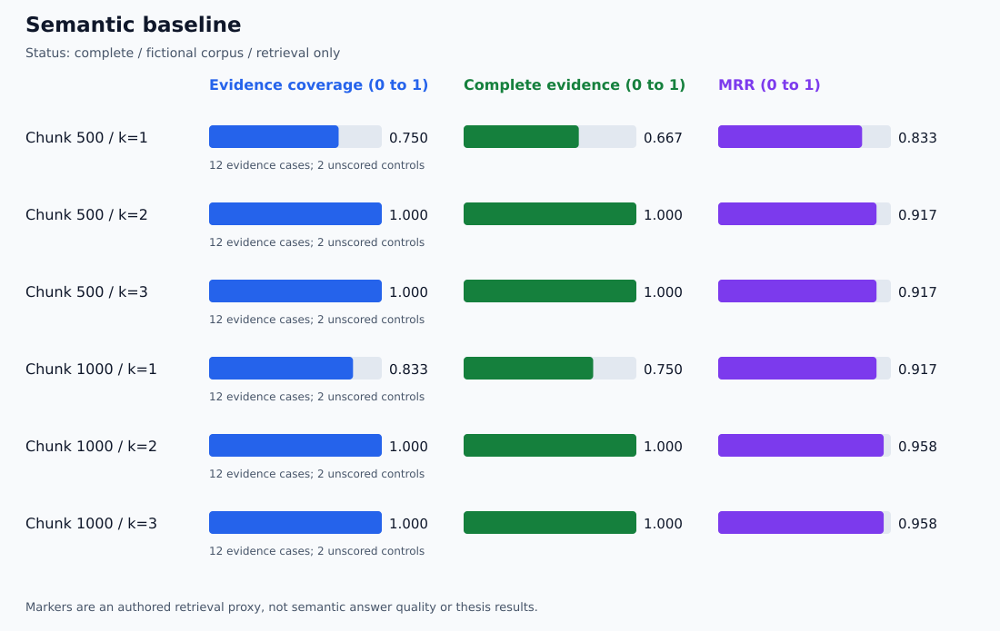

# 🔬 Identifier-Priority Comparison: First Local Run Audit

**🟩 Completed paired run · 🟩 Saved evidence reproduced · 🟠 Interactive answer check pending**

## 🗂️ Run identity

| Field | Recorded value |
| --- | --- |
| Run | 20261110T200859Z-0651f827 |
| Evaluated code | 845b926488b5f03b69beee43944761fcc6fc4426 |
| Original evidence commit | [cfb373f](https://github.com/anne500/document-rag-qa-agent/commit/cfb373f) |
| Model | nomic-embed-text:latest |
| Model digest | 0a109f422b47e3a30ba2b10eca18548e944e8a23073ee3f3e947efcf3c45e59f |
| Corpus | Three Markdown files and two PDF pages |
| Chunk settings | 500 and 1000 characters; overlap 200 |
| Indexed chunks | 7 and 5 respectively |
| Semantic pool | Requested up to 20; actual pools contained all 7 or 5 chunks |
| Cases | 12 authored evidence questions and 2 unscored no-evidence controls |
| Comparisons | Two methods at k=1,2,3 for each chunk size |

## 📊 Paired results

| Chunk | k | Method | Hit | Complete | Coverage | MRR | Precision |
| ---: | ---: | --- | ---: | ---: | ---: | ---: | ---: |
| 500 | 1 | semantic | 0.833 | 0.667 | 0.750 | 0.833 | 0.833 |
| 500 | 1 | id_priority | 0.917 | 0.750 | 0.833 | 0.917 | 0.917 |
| 500 | 2 | semantic | 1.000 | 1.000 | 1.000 | 0.917 | 0.583 |
| 500 | 2 | id_priority | 1.000 | 1.000 | 1.000 | 0.958 | 0.583 |
| 500 | 3 | semantic | 1.000 | 1.000 | 1.000 | 0.917 | 0.389 |
| 500 | 3 | id_priority | 1.000 | 1.000 | 1.000 | 0.958 | 0.389 |
| 1000 | 1 | semantic | 0.917 | 0.750 | 0.833 | 0.917 | 0.917 |
| 1000 | 1 | id_priority | 1.000 | 0.833 | 0.917 | 1.000 | 1.000 |
| 1000 | 2 | semantic | 1.000 | 1.000 | 1.000 | 0.958 | 0.583 |
| 1000 | 2 | id_priority | 1.000 | 1.000 | 1.000 | 1.000 | 0.583 |
| 1000 | 3 | semantic | 1.000 | 1.000 | 1.000 | 0.958 | 0.389 |
| 1000 | 3 | id_priority | 1.000 | 1.000 | 1.000 | 1.000 | 0.389 |

Each aggregate averages only the 12 evidence cases.
These values measure authored source/page/text markers, not generated-answer accuracy.

### 🔵 Semantic baseline

### 🟣 Whole-ID priority

## 🔎 Maple: preserved before and after

For the misleading MAPLE-207 disk-space question, both chunk configurations
selected Birch at semantic rank 1 and Maple at semantic rank 2.
The identifier method promoted Maple to rank 1 with selection reason exact_id
and retained its original semantic rank of 2 in the report.

At k=1, this single question changed from a marker miss to complete evidence.
Complete-evidence rate therefore increased by 1/12, or approximately 8.3
percentage points, at each chunk size.

## 🧪 Artifact checks

The published evidence was inspected without rerunning embeddings:

- Dataset and corpus snapshot hashes match the report.
- All five evaluated code hashes match the recorded repository source using
  Windows CRLF checkout representations.
- All 12 indexed chunks belong to their recorded source/page text.
- All 168 semantic candidate entries belong to the corpus snapshot.
- All 28 identifier traces reproduce from the indexed inventory and shared pools.
- All 56 method rankings reproduce, including selection reasons and original ranks.
- All 168 per-k score records recompute from the saved ranked passages.
- All 72 per-case delta rows match the recomputed changes.
- All 12 CSV aggregate rows match the scores.
- Both SVG charts match the recomputed aggregates.
- All 12 semantic-fallback pairs retain identical method results.
- No negative deltas occurred for Hit, Complete, Coverage, MRR, or Precision
  in this run's evidence cases and tested settings.

These checks establish internal evidence consistency and reproducibility of
the deterministic ranking/scoring steps. They do not independently authenticate
the run's origin or reproduce the embedding service execution.

## 🧭 Interpretation and working settings

The observed gain is rank ordering: the Maple passage was already in the
semantic pool. The live pools included every indexed chunk, so this run does
not establish a benefit from selecting exact-ID evidence outside a truncated pool.
That behavior has controlled offline test coverage only.

Keep chunk size 1000 and k=2 for multi-source questions. At 1000/k=1,
ID priority hit some supporting evidence for every evidence case, but complete
coverage was only 10/12. Both methods reached complete marker coverage at k=2.

The interactive application still defaults to semantic retrieval.
ID priority is available explicitly and awaits a manual answer/citation check.
No answer-quality improvement or default-mode change is claimed.

## ⚠️ Remaining limits

- This is one small development-set run on fictional documents.
- The dataset includes no unknown-ID query; unknown-ID behavior is offline-tested.
- Fallback equality here is relative to the paired shared semantic pools.
- Exact-ID mentions can be stale, negated, irrelevant, or duplicated.
- No semantic entailment, answer accuracy, abstention quality, or held-out
  generalization is established.
- Timing observations do not support a speed comparison.
- Zero observed regressions does not guarantee regression-free behavior.

## 🔗 Evidence and attribution

- [Generated paired dashboard](identifier-runs/20261110T200859Z-0651f827/summary.md)
- [Full report](identifier-runs/20261110T200859Z-0651f827/report.json)
- [Per-case deltas](identifier-runs/20261110T200859Z-0651f827/paired-deltas.json)
- [Method and colored architecture](../guides/IDENTIFIER_RETRIEVAL.md)
- [Central verification dashboard](DASHBOARD.md)
- [Darsh Shah/freeCodeCamp acknowledgment](../README.md#tutorial-acknowledgment-and-attribution)
