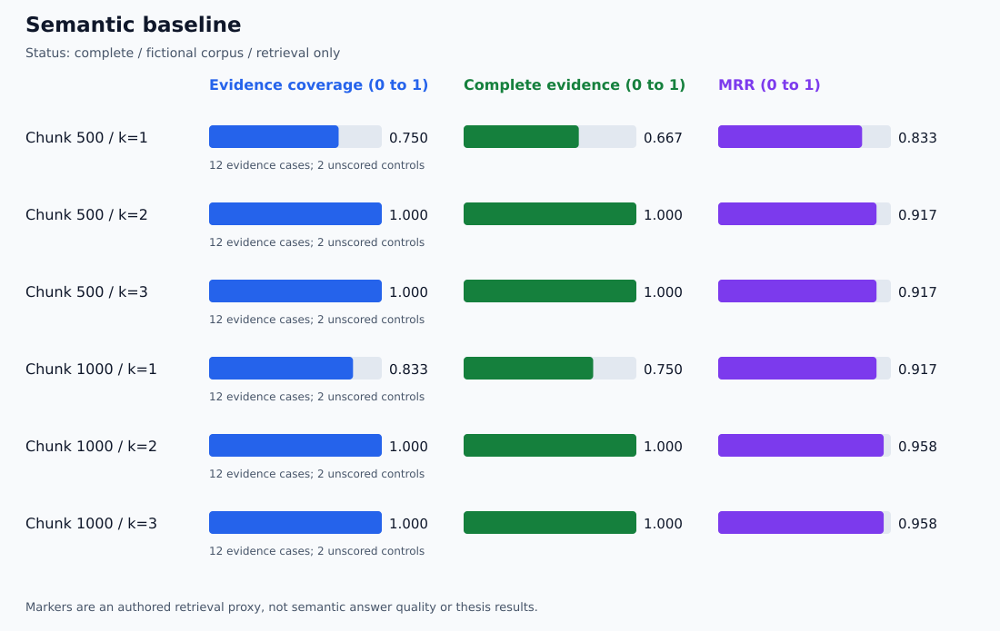

# Identifier-Aware Retrieval Dashboard

Run status: **complete**

## Paired aggregate comparison

| Chunk | k | Method | Hit | Complete | Coverage | MRR | Precision |
| --- | --- | --- | --- | --- | --- | --- | --- |
| 500 | 1 | semantic | 0.833 | 0.667 | 0.750 | 0.833 | 0.833 |
| 500 | 1 | id_priority | 0.917 | 0.750 | 0.833 | 0.917 | 0.917 |
| 500 | 2 | semantic | 1.000 | 1.000 | 1.000 | 0.917 | 0.583 |
| 500 | 2 | id_priority | 1.000 | 1.000 | 1.000 | 0.958 | 0.583 |
| 500 | 3 | semantic | 1.000 | 1.000 | 1.000 | 0.917 | 0.389 |
| 500 | 3 | id_priority | 1.000 | 1.000 | 1.000 | 0.958 | 0.389 |
| 1000 | 1 | semantic | 0.917 | 0.750 | 0.833 | 0.917 | 0.917 |
| 1000 | 1 | id_priority | 1.000 | 0.833 | 0.917 | 1.000 | 1.000 |
| 1000 | 2 | semantic | 1.000 | 1.000 | 1.000 | 0.958 | 0.583 |
| 1000 | 2 | id_priority | 1.000 | 1.000 | 1.000 | 1.000 | 0.583 |
| 1000 | 3 | semantic | 1.000 | 1.000 | 1.000 | 0.958 | 0.389 |
| 1000 | 3 | id_priority | 1.000 | 1.000 | 1.000 | 1.000 | 0.389 |

## Complete-evidence changes by question

| Chunk | k | Improved | Regressed | Unchanged |
| --- | --- | --- | --- | --- |
| 500 | 1 | 1 | 0 | 11 |
| 500 | 2 | 0 | 0 | 12 |
| 500 | 3 | 0 | 0 | 12 |
| 1000 | 1 | 1 | 0 | 11 |
| 1000 | 2 | 0 | 0 | 12 |
| 1000 | 3 | 0 | 0 | 12 |

## Semantic baseline

## Whole-ID priority

The two methods use the same semantic candidate list for each question. The priority method can also select exact-ID chunks outside that pool.

Source IDs, page numbers, full text, original semantic ranks, selection reasons, unknown IDs, and per-case scores are in report.json. All metric deltas, including regressions, are in paired-deltas.json.

Only authored evidence-marker retrieval is evaluated. No answer generation, abstention accuracy, held-out generalization, or general superiority is established. No-evidence controls are unscored.
