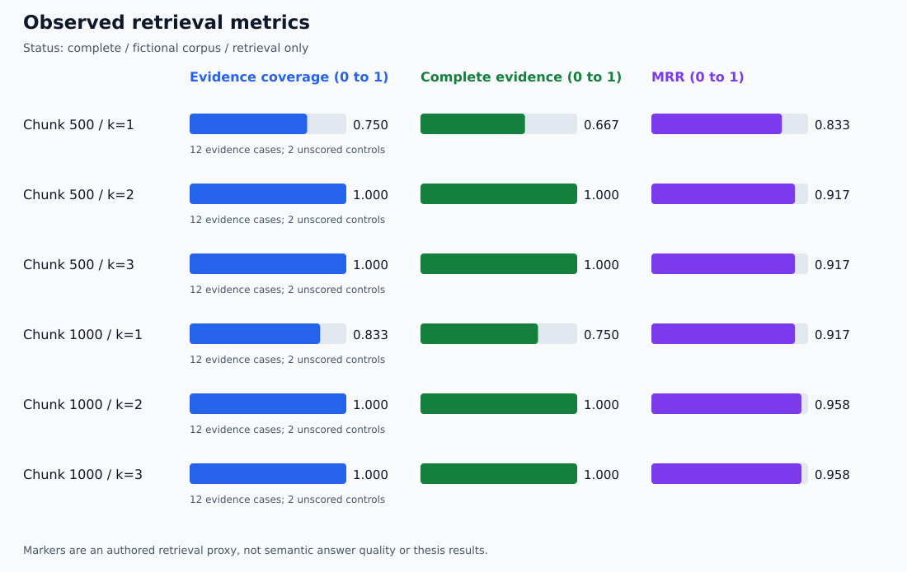

# 🔬 First Local Retrieval Run: Evidence Audit

**🟩 Completed local run · 🟩 Evidence recomputed · 🟠 Small development set**

## 🗂️ Run identity

| Field | Recorded value |
| --- | --- |
| Run | 20261110T184155Z-a94eff34 |
| Platform | Windows, Python 3.12.10 |
| Evaluated source commit | bc3b108e16a53ace839203348baadb651fd247f1 |
| Original evidence publication | [5ff1c9c](https://github.com/anne500/document-rag-qa-agent/commit/5ff1c9c) |
| Embedding model | nomic-embed-text:latest |
| Recorded digest | 0a109f422b47e3a30ba2b10eca18548e944e8a23073ee3f3e947efcf3c45e59f |
| Corpus | Three Markdown documents and two Atlas PDF pages |
| Questions | 12 authored evidence cases and 2 unscored no-evidence controls |
| Chunk configurations | 500 characters: 7 chunks; 1000 characters: 5 chunks |
| Overlap | 200 characters |
| Retrieval settings | Prefixes at k=1,2,3 from one top-3 search per question/configuration |

## 🎨 Measured results

| Chunk size | k | Hit | Complete | Coverage | MRR | Precision |
| ---: | ---: | ---: | ---: | ---: | ---: | ---: |
| 500 | 1 | 0.833 | 0.667 | 0.750 | 0.833 | 0.833 |
| 500 | 2 | 1.000 | 1.000 | 1.000 | 0.917 | 0.583 |
| 500 | 3 | 1.000 | 1.000 | 1.000 | 0.917 | 0.389 |
| 1000 | 1 | 0.917 | 0.750 | 0.833 | 0.917 | 0.917 |
| 1000 | 2 | 1.000 | 1.000 | 1.000 | 0.958 | 0.583 |
| 1000 | 3 | 1.000 | 1.000 | 1.000 | 0.958 | 0.389 |

These are authored marker-based retrieval scores, not generated-answer accuracy.
All aggregates exclude the two no-evidence controls.

## 🧪 Artifact checks

The published report and snapshots were inspected after the local run:

- All 28 case records across the two chunk configurations are present.
- All 84 k-specific score records were recomputed from the saved ranked chunks.
- All 84 ranked passages belong to their recorded source and page in the corpus snapshot.
- Matched evidence-group labels agree with the authored markers.
- Dataset and corpus snapshot hashes match the report.
- Recorded code hashes match the evaluated repository files when represented
  with Windows CRLF checkout line endings.
- All six CSV summary rows agree with the recomputed aggregates.
- The saved SVG agrees with the chart rendered from those aggregates.
- The report records completed status and the embedding model digest.

This checks internal consistency and provenance of the published evidence.
It does not independently rerun the embedding model or authenticate the
origin of a self-reported run.

## 🔎 Diagnostic cases

| Case | Rank 1 | Rank 2 | Interpretation |
| --- | --- | --- | --- |
| Misleading MAPLE-207 question | Birch; no matching group | Maple; expired certificate evidence | k=1 misses the supporting evidence; k=2 recovers it |
| Atlas cross-page question | Atlas page 2; failed token | Atlas page 1; approval roles | k=1 covers one of two required groups; k=2 covers both |

These rank patterns occurred with both chunk sizes.
At k=3, the added passage matched no additional required group in either case.

## 🧭 Working setting and limits

Keep the interactive demo at chunk size 1000 and k=2.
In this run, it covered all authored evidence groups with higher MRR than
500/k=2. Increasing k from 2 to 3 added no coverage and lowered precision.
This supports a working demo choice, not a generally optimal configuration.

There was one run, a tiny fictional corpus, and development questions.
No held-out generalization, statistical significance, generated-answer quality,
citation entailment, or no-answer detection is established.

## 🛠️ CSV formatting correction

The original CSV contained doubled CR characters at line boundaries because
the CSV writer's CRLF output underwent Windows text newline translation.
Git flagged these carriage returns as trailing whitespace.

Only the CSV line endings were normalized to LF. Its header and numeric cell
values are unchanged. The original CSV remains available in commit 5ff1c9c.
The report JSON, snapshots, recorded code hashes, and chart were not rewritten.

The runner now explicitly emits LF CSV and disables newline translation for
that write. A dedicated regression test was added: 22 offline tests passed
after the fix. The user also recorded 21 passing Windows tests before the fix.

## 📚 Source and related evidence

- [Generated run dashboard](retrieval-runs/20261110T184155Z-a94eff34/summary.md)
- [Full report](retrieval-runs/20261110T184155Z-a94eff34/report.json)
- [CSV](retrieval-runs/20261110T184155Z-a94eff34/metrics.csv)
- [Lab method and metric definitions](../guides/RETRIEVAL_LAB.md)
- [Central verification dashboard](DASHBOARD.md)
- [Darsh Shah tutorial acknowledgment](../README.md#tutorial-acknowledgment-and-attribution)
