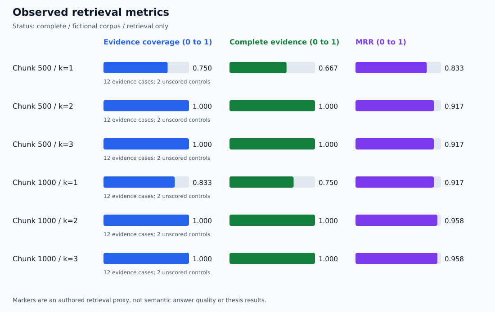

# Retrieval Evaluation Dashboard

Run status: **complete**

| Chunk | k | Hit | Complete | Coverage | MRR | Precision |
| --- | --- | --- | --- | --- | --- | --- |
| 500 | 1 | 0.833 | 0.667 | 0.750 | 0.833 | 0.833 |
| 500 | 2 | 1.000 | 1.000 | 1.000 | 0.917 | 0.583 |
| 500 | 3 | 1.000 | 1.000 | 1.000 | 0.917 | 0.389 |
| 1000 | 1 | 0.917 | 0.750 | 0.833 | 0.917 | 0.917 |
| 1000 | 2 | 1.000 | 1.000 | 1.000 | 0.958 | 0.583 |
| 1000 | 3 | 1.000 | 1.000 | 1.000 | 0.958 | 0.389 |

Metrics average only evidence cases. No-evidence controls are unscored and cannot establish abstention quality.

Per-case ranks, full retrieved text, PDF pages, distances, marker matches, settings, hashes, and model identity are in report.json.

One search at the largest k supplies shared ranking prefixes. Query timings therefore do not measure separate k configurations.

These are small, authored, development-set results. They are not a held-out benchmark, general accuracy claim, or thesis experiment.
